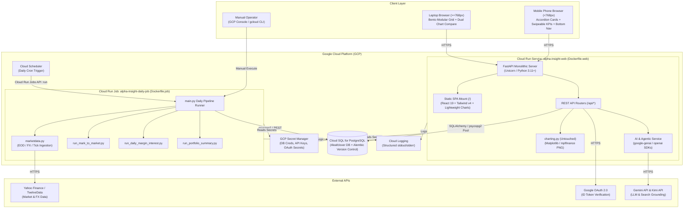

# System Architecture Document — Alpha_Insight

**Document Path:** `Epics/0.1/SYSTEM_ARCHITECTURE.md`  
**Repository:** `https://github.com/ferriskwan/Alpha_Insight`  
**Local Workspace:** `C:\Users\ferri\devt\Alpha_Insight`  
**Status:** Canonical Architecture Reference (Mandatory for all builds)

---

## 1. High-Level System Topology

`Alpha_Insight` is a monolithic full-stack codebase deployed on Google Cloud Platform (GCP) as two workload artefacts built from the same repository and connected to the shared `4leafclover` Cloud SQL PostgreSQL database:
1. **`alpha-insight-web` (Cloud Run Service):** Runs the FastAPI server hosting the compiled React 19 SPA (`/`), REST APIs (`/api/*`), AI analysis orchestrator, and untouched `charting.py` renderer.
2. **`alpha-insight-daily-job` (Cloud Run Job):** Runs the standalone daily batch pipeline (`main.py`), triggered automatically every day by **GCP Cloud Scheduler** or executed manually on-demand from the GCP Console / CLI.



---

## 2. Monorepo Directory Structure

All application code, database migrations, container definitions, tests, and epic documentation reside in `C:\Users\ferri\devt\Alpha_Insight`:

```text
Alpha_Insight/
├── Epics/
│   └── 0.1/
│       ├── PRD.md
│       ├── SYSTEM_ARCHITECTURE.md
│       ├── UI_DESIGN.md
│       ├── IMPLEMENTATION_PLAN.md
│       └── mockups/
│           ├── ui_option_1_obsidian_terminal.jpg
│           ├── ui_option_2_bento_modular_dark.jpg
│           └── ui_option_3_agentic_workspace.jpg
├── .agents/
│   ├── PRD.md                    # Synchronized PRD reference for agent orchestrator
│   ├── UAT_CHECKLIST.json        # Deterministic machine-readable acceptance tests
│   ├── contracts/                # Frozen Pydantic / TypeScript schemas for Swarm Mode
│   └── tasks/                    # Federated stream logs (stream_be.md, stream_fe.md, stream_qa.md)
├── alembic/                      # Database migration scripts & env.py
│   ├── versions/
│   │   ├── 0001_baseline_4leafclover_schema.py
│   │   └── 0002_pipeline_job_logs_and_sessions.py
│   └── env.py
├── alembic.ini
├── charting.py                   # UNTOUCHED Matplotlib/mplfinance charting script copied from AlphaInsight
├── main.py                       # Daily batch pipeline entrypoint for Cloud Run Job & manual CLI execution
├── marketdata.py                 # Yahoo Finance & TwelveData fetcher module copied from 4leafclover
├── ProcessData.py                # Core PostgreSQL operations module copied from 4leafclover
├── run_mark_to_market.py         # Daily position valuation batch script copied from 4leafclover
├── run_daily_margin_interest.py  # Daily margin loan & interest batch script copied from 4leafclover
├── run_portfolio_summary.py      # Daily portfolio summary snapshot batch script copied from 4leafclover
├── backend/                      # Unified Python 3.11+ FastAPI Web Backend
│   ├── __init__.py
│   ├── main.py                   # FastAPI entrypoint, lifespan pool, SPA static file mount
│   ├── config.py                 # Pydantic BaseSettings (env vars & Secret Manager)
│   ├── dependencies.py           # Auth dependencies (require_auth, require_admin, verify_api_key)
│   ├── db/
│   │   ├── __init__.py
│   │   ├── session.py            # SQLAlchemy engine & psycopg2 ThreadedConnectionPool
│   │   └── models.py             # SQLAlchemy 2.0 declarative models (15 tables)
│   ├── schemas/                  # Pydantic v2 request/response contracts
│   │   ├── auth.py
│   │   ├── market.py
│   │   ├── portfolio.py
│   │   ├── transactions.py
│   │   ├── analysis.py
│   │   └── jobs.py
│   ├── repositories/             # Domain data access layer wrapping ProcessData / SQLAlchemy
│   │   ├── user_repo.py
│   │   ├── market_repo.py
│   │   ├── portfolio_repo.py
│   │   └── sys_repo.py
│   ├── services/                 # Stateless business logic & external integrations
│   │   ├── chart_runner.py       # Invokes untouched charting.py using OS-agnostic tempfile.TemporaryDirectory
│   │   ├── prompt_builder.py     # Multi-horizon prompt builder
│   │   └── agent_orchestrator.py # Gemini / Kimi analysis & future agentic tool runner
│   └── api/
│       └── v1/                   # FastAPI modular routers
│           ├── auth.py           # /api/auth/* (Google OAuth, sessions, env)
│           ├── dataops.py        # /api/v1/* (EOD, FX, Tick, SysInit endpoints for main.py compatibility)
│           ├── watchlist.py      # /api/watchlist/* & /api/transactions/watchlist
│           ├── portfolio.py      # /api/portfolio/*
│           ├── transactions.py   # /api/transactions/trade, capital, sysvalue
│           ├── admin.py          # /api/admin/users/* & job execution history
│           └── analysis.py       # /api/analyze
├── frontend/                     # React 19 + TypeScript + Tailwind CSS v4 + Vite (Option 2 Bento UI)
│   ├── index.html
│   ├── package.json
│   ├── tsconfig.json
│   ├── vite.config.ts
│   └── src/
│       ├── main.tsx
│       ├── App.tsx
│       ├── index.css             # Tailwind v4 @theme semantic tokens & CSS variables
│       ├── design-system/        # Centralized Design System (Zero Hardcoding in Feature Views)
│       │   ├── index.ts          # Barrel export for tokens and primitives
│       │   ├── tokens.ts         # Typed color, typography, spacing, and chart palette tokens
│       │   └── components/
│       │       ├── BentoCard.tsx
│       │       ├── AccordionCard.tsx
│       │       ├── PillToggle.tsx
│       │       ├── SegmentedControl.tsx
│       │       ├── Button.tsx
│       │       ├── FormField.tsx
│       │       ├── MetricCard.tsx
│       │       ├── SwipeableKpiStrip.tsx
│       │       ├── ResponsiveTable.tsx
│       │       └── Badge.tsx
│       ├── types/                # Shared TypeScript interfaces matching backend/schemas/
│       ├── services/             # Typed API client functions
│       ├── lib/                  # Shared client utilities (promptBuilder.ts)
│       ├── hooks/                # Custom hooks (useViewport, useTouchSlider, useAuth)
│       └── components/
│           ├── layout/           # BentoAppShell, TopCommandBar, LeftNavRail, MobileFloatingBar
│           ├── auth/             # LoginScreen
│           ├── analyst/          # StockAnalyst, ModulePillToggles, ChartComparisonView,
│           │                     # MatplotlibChartView, InteractiveCanvasChart, ReportView, RawDataView
│           ├── portfolio/        # PortfolioManager, BalanceMatrixCard,
│           │                     # PerformanceCurveCard, DualLedgerPnL
│           ├── editor/           # TransactionEditor
│           ├── admin/            # AdminPanel, JobExecutionLogCard
│           └── faq/              # FAQ
├── tests/
│   ├── backend/                  # Pytest unit, integration, and contract tests
│   └── frontend/                 # Vitest component, hook, and design-system compliance tests
├── Dockerfile.web                # Multi-stage build for Cloud Run Service (Node Vite build + Python FastAPI)
├── Dockerfile.job                # Lightweight Python build for Cloud Run Job (main.py batch runner)
├── cloudbuild.yaml               # GCP Cloud Build CI/CD pipeline for both containers
└── pyproject.toml                # uv package manager, ruff, mypy, pytest configuration
```

---

## 3. Dual Charting Architecture (`charting.py` + Client-Side Canvas)

To allow direct visual and functional evaluation between the existing server-rendered Matplotlib chart and a client-side HTML5 canvas library:

1. **Path A — Untouched `charting.py` (Server-Rendered PNG + SVG Overlay):**
   * `charting.py` is copied byte-for-byte from `AlphaInsight` into the root of `Alpha_Insight` and remains untouched.
   * `backend/services/chart_runner.py` writes the EOD + trades JSON payload into a cross-platform `tempfile.TemporaryDirectory()`, invokes `sys.executable charting.py candlestick <json_path> <png_path> [--zoom-start ...] [--zoom-end ...]`, reads the resulting PNG into base64, and automatically cleans up the temporary directory.
   * The base64 PNG is returned in `GET /api/watchlist/data` (`chartScreenshot`) and rendered in `MatplotlibChartView.tsx` (upgraded with mobile touch event handlers `onTouchStart`/`onTouchMove` alongside mouse hover) and attached to `POST /api/analyze` when Vision Chart Pattern Recognition is enabled.
2. **Path B — Interactive Client-Side Canvas (`InteractiveCanvasChart.tsx`):**
   * Uses TradingView `lightweight-charts` in the browser to render the raw `eodData.values` and `trades` returned by `GET /api/watchlist/data` using colors imported from `DESIGN_TOKENS.chart` (`frontend/src/design-system/tokens.ts`).
   * Computes and plots identical indicators client-side: Candlesticks, SMA(30), EMA(100), Bollinger Bands(30, 2), active-window Fibonacci retracement lines (`0%`, `23.6%`, `38.2%`, `50.0%`, `61.8%`, `78.6%`, `100%`), Buy/Sell/Mixed trade markers, RSI(13) pane, MACD(12, 26, 9) pane, and Volume pane.
   * Supports hardware-accelerated 60fps pinch-to-zoom, kinetic touch scrolling on mobile, and synchronized crosshairs across subplots.
3. **Comparison Switcher (`ChartComparisonView.tsx`):**
   * A `SegmentedControl` primitive from `frontend/src/design-system/` in the Stock Analyst Bento card lets the user switch between:
     * `Matplotlib (charting.py)`
     * `Interactive Canvas`
     * `Split Compare` (renders both stacked/side-by-side for identical zoom windows).

---

## 4. Database Architecture & Alembic Strategy

### 4.1 Existing `4leafclover` Schema (Baseline `0001`)
All 13 existing tables in the `public` schema are preserved and mapped to SQLAlchemy 2.0 declarative models in `backend/db/models.py`:

| Table Name | Primary Key / Unique Constraint | Purpose |
| :--- | :--- | :--- |
| `users` | `id` (PK), `email` (Unique) | Registered tenant profiles and Google SSO identifiers (`status`: `active` / `expired`). |
| `user_roles` | `id` (PK), `(user_id, role)` | Role assignments (`admin`, `user`) with `active` / `expired` status. |
| `sysvalue` | `name` (PK) | System parameters (`GLOBAL_STARTDATE`, `GLOBAL_TODAY`, `ENV`). |
| `watchlist` | `(user_id, watchlistname, symbol)` | User-scoped tracked securities, exchange timezones, and native currencies. |
| `eoddata` | `(symbol, date)` | Daily OHLCV market bars. |
| `tickdata` | `(symbol, interval, timestamp)` | Intraday (`5m`) OHLCV market bars. |
| `exchange_rate` | `(date, currency, base_currency)` | Daily FX conversion rates against `USD`. |
| `trade` | `id` (PK) | User buy/sell execution logs (`investment`: `TRUE` = Cash/Long-Term, `FALSE` = Margin/Tactical). |
| `capital` | `id` (PK) | Broker cash/margin deposits (`D`), withdrawals (`W`), initial funding (`I`), and FX conversions (`F`). |
| `position` | `(user_id, tradedate, symbol, investment)` | Daily mark-to-market open position snapshots (`avgprice`, `quantity`, `eodprice`). |
| `margin_interest_rate` | `id` (PK) | Broker and currency annual interest rate rules and day-count basis (`360` / `365`). |
| `daily_margin_interest` | `(user_id, date, broker, currency)` | Daily accrued and cumulative margin borrowing interest. |
| `daily_portfolio_summary` | `(user_id, date, currency, investment)` | Daily consolidated portfolio KPIs (`total_capital`, `position_market_value`, `realized_pnl`, `unrealized_pnl`, `margin_loan_balance`, `total_pnl`, `pct_pnl`). |

### 4.2 New Tables Added via Alembic (`0002`)
1. **`user_sessions`**:
   * Columns: `sid VARCHAR(128) PRIMARY KEY`, `user_id INTEGER REFERENCES users(id)`, `expires_at TIMESTAMP WITH TIME ZONE NOT NULL`, `created_at TIMESTAMP WITH TIME ZONE DEFAULT CURRENT_TIMESTAMP`.
   * Purpose: Replaces the volatile in-memory `Map` in `server.ts` so user authentication sessions persist across Cloud Run container instances.
2. **`job_execution_log`**:
   * Columns: `id SERIAL PRIMARY KEY`, `job_name VARCHAR(64) NOT NULL`, `trigger_source VARCHAR(32) NOT NULL`, `started_at TIMESTAMP WITH TIME ZONE NOT NULL`, `completed_at TIMESTAMP WITH TIME ZONE`, `status VARCHAR(16) NOT NULL`, `global_today DATE`, `details JSONB`, `error_message TEXT`.
   * Purpose: Records every scheduled and manual run of the `alpha-insight-daily-job` Cloud Run Job.

---

## 5. GCP Cloud Run Job & Cloud Scheduler Architecture

### 5.1 Standalone Cloud Run Job (`alpha-insight-daily-job`)
* **Container Image:** Built via `Dockerfile.job` with entrypoint `["python", "main.py"]`.
* **Execution Modes:**
  * **Scheduled Daily Run:** GCP Cloud Scheduler invokes the Cloud Run Jobs API (`POST https://<region>-run.googleapis.com/apis/run.googleapis.com/v1/namespaces/<project>/jobs/alpha-insight-daily-job:run`) using a dedicated IAM Service Account with `roles/run.invoker` and `roles/run.jobsExecutorWithOverrides`.
  * **On-Demand Manual Run:** Executable anytime by the user via:
    * GCP Console UI: **Cloud Run -> Jobs -> `alpha-insight-daily-job` -> Execute**
    * CLI: `gcloud run jobs execute alpha-insight-daily-job --region <region>`
    * Local Workstation: `uv run python main.py`

---

## 6. Architectural Invariants & Engineering Standards

1. **Non-Destructive Legacy Source Isolation:**
   * `c:\Users\ferri\OneDrive\Documents\AlphaInsight` and `c:\Users\ferri\OneDrive\Documents\4leafclover` are strictly read-only reference directories.
   * Reusable modules are copied into `C:\Users\ferri\devt\Alpha_Insight` before any modification occurs.
2. **Centralized Design System Enforcement (Zero Hardcoding):**
   * Every UI view in `frontend/src/components/` must consume tokens and UI primitives from `frontend/src/design-system/` and `frontend/src/index.css`.
   * Arbitrary Tailwind hex colors (e.g., `bg-[#...]`, `text-[#...]`, `border-[#...]`), inline hex color strings, and hardcoded backend URLs inside feature components are forbidden and checked via automated tests.
3. **Package & Environment Management:**
   * Python dependencies are managed via `uv` (`pyproject.toml`). All Python commands must be executed via `uv run` (`uv run pytest`, `uv run ruff check .`, `uv run mypy backend`, `uv run alembic`).
   * `charting.py` is listed in `pyproject.toml` under `[tool.ruff] extend-exclude = ["charting.py"]` so static linters never modify the untouched file.
4. **Configuration & Secrets:**
   * All secrets and environment variables (`DB_HOST`, `DB_PORT`, `DB_NAME`, `DB_USER`, `DB_PASSWORD`, `GOOGLE_CLIENT_ID`, `GEMINI_API_KEY`, `KIMI_API_KEY`, `TWELVEDATA_API_KEY`, `API_KEY`) are loaded via `backend/config.py` and injected from GCP Secret Manager in Cloud Run/Job environments.
