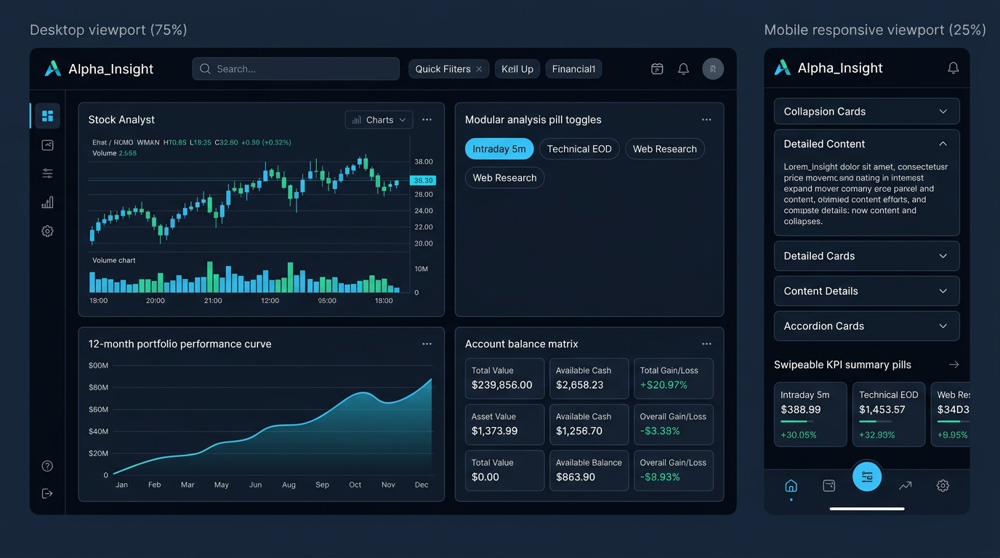

# UI Design Specification — Epic 0.1: Alpha_Insight Design System (Option 2: Bento Modular Dark)

**Document Path:** `Epics/0.1/UI_DESIGN.md`  
**Repository:** `https://github.com/ferriskwan/Alpha_Insight`  
**Local Workspace:** `C:\Users\ferri\devt\Alpha_Insight`  
**Selected Direction:** Option 2 — Bento Modular Dark  
**Stored Mockups Directory:** `Epics/0.1/mockups/`

---

## 1. Design Philosophy & Mandatory Design System Architecture

`Alpha_Insight` implements a centralized, token-driven **Bento Modular Dark Design System** (`frontend/src/design-system/`).
* **Strict No-Hardcoding Mandate:** Feature views (`LoginScreen`, `StockAnalyst`, `PortfolioManager`, `TransactionEditor`, `AdminPanel`, `FAQ`) are strictly forbidden from using inline hex color literals (such as `bg-[#111827]` or `text-[#38BDF8]`), arbitrary pixel magic numbers, or one-off button/card markup. Every screen must import semantic CSS tokens from `frontend/src/index.css` and shared React UI primitives from `frontend/src/design-system/`.
* **Desktop (`>= 768px`):** 12-column Bento card grid with a left icon navigation rail and top command bar.
* **Mobile (`< 768px`):** Single-column vertical stack with a horizontal swipeable KPI pill strip, collapsible `AccordionCard` containers, responsive record cards, and a floating 5-icon bottom navigation bar.

---

## 2. Design System Semantic Tokens (`frontend/src/index.css` & `tokens.ts`)

All colors are defined once in `:root` / `@theme` and mapped to semantic Tailwind v4 utility classes:

| Semantic Token / Utility Class | CSS Variable | Hex | RGB | Usage |
| :--- | :--- | :--- | :--- | :--- |
| `bg-canvas` | `--color-canvas` | `#090D16` | `rgb(9, 13, 22)` | Root application viewport background |
| `bg-bento-card` | `--color-bento-card` | `#111827` | `rgb(17, 24, 39)` | Primary Bento card surface, accordion containers, table surfaces |
| `bg-surface-elevated` | `--color-surface-elevated` | `#1E293B` | `rgb(30, 41, 59)` | Command bar inputs, unselected pills, hover rows, floating bottom nav |
| `border-subtle` | `--color-border-subtle` | `#1F2937` | `rgb(31, 41, 55)` | Default `1px solid` card, input, and table dividers |
| `border-active` | `--color-border-active` | `#38BDF8` | `rgb(56, 189, 248)` | Active focus rings and selected card/pill borders |
| `text-primary` | `--color-text-primary` | `#F8FAFC` | `rgb(248, 250, 252)` | Headings, ticker symbols, active labels, primary KPI numerals |
| `text-secondary` | `--color-text-secondary` | `#94A3B8` | `rgb(148, 163, 184)` | Subtitles, table headers, markdown body text |
| `text-muted` | `--color-text-muted` | `#64748B` | `rgb(100, 116, 139)` | Timestamps, axis labels, disabled states, helper captions |
| `accent-primary` | `--color-accent-primary` | `#38BDF8` | `rgb(56, 189, 248)` | Primary CTA buttons, active pill fills, mobile center nav action |
| `accent-secondary` | `--color-accent-secondary` | `#6366F1` | `rgb(99, 102, 241)` | Secondary badges, indicator overlays |
| `semantic-positive` | `--color-semantic-positive` | `#34D399` | `rgb(52, 211, 153)` | Positive PnL, bullish candles, `BUY` badges, success alerts |
| `semantic-negative` | `--color-semantic-negative` | `#FB7185` | `rgb(251, 113, 133)` | Negative PnL, margin loan balances, bearish candles, `SELL` badges |
| `semantic-warning` | `--color-semantic-warning` | `#FBBF24` | `rgb(251, 191, 36)` | Intraday `5m` badges, caution banners, Fibonacci callouts |

---

## 3. Shared Design System Component Primitives (`frontend/src/design-system/`)

Every UI screen must be composed from these standardized components:

| Component | File Path | Responsibility |
| :--- | :--- | :--- |
| `BentoCard` | `design-system/BentoCard.tsx` | Standardized container (`bg-bento-card border border-subtle rounded-xl p-3.5 md:p-5`) with optional `title`, `subtitle`, `icon`, `headerRight` slot, and `noPadding` prop. |
| `AccordionCard` | `design-system/AccordionCard.tsx` | Responsive card that renders expanded on desktop or as a collapsible accordion on mobile (`< 768px`) with animated chevron (`200ms`) and `aria-expanded` accessibility. |
| `PillToggle` | `design-system/PillToggle.tsx` | Rounded pill toggle (`rounded-full px-3 py-1.5 text-xs font-semibold`) with active (`bg-accent-primary text-canvas`) and inactive (`bg-surface-elevated text-secondary`) states. |
| `SegmentedControl` | `design-system/SegmentedControl.tsx` | Multi-option segmented switcher used for the Chart Engine Switcher (`charting.py` \| `Interactive Canvas` \| `Split Compare`), Portfolio sub-tabs, and Editor entity tabs. |
| `Button` / `IconButton` | `design-system/Button.tsx` | Variants: `primary`, `secondary`, `danger`, `ghost`. Enforces `min-h-[44px] md:min-h-[36px]`, loading spinner state, `active:scale-[0.98]`, and `focus-visible:ring-2`. |
| `FormField` (`Input`, `Select`) | `design-system/FormField.tsx` | Unified label + input/select wrapper enforcing consistent typography, dark calendar picker scheme, error message slot, and focus border tokens. |
| `MetricCard` & `SwipeableKpiStrip` | `design-system/MetricCard.tsx` | Renders a 5-column KPI grid on desktop and a horizontal snap-scrolling pill strip (`snap-x snap-mandatory`) on mobile. |
| `ResponsiveTable` | `design-system/ResponsiveTable.tsx` | Accepts column definitions and row data; renders a sticky-header monospace table on `>= 640px` and stacked key-value mobile cards on `< 640px` with an optional table/card view toggle. |
| `Badge` & `EnvPill` | `design-system/Badge.tsx` | Semantic status badges (`BUY`, `SELL`, `CASH`, `MARGIN`, `ACTIVE`, `EXPIRED`) and environment indicator (`[DEV]`, `[UAT]`, `[PRD]`). |

---

## 4. Typography Hierarchy

* **UI & Prose Font Family (`--font-sans`):** `'Inter', -apple-system, BlinkMacSystemFont, sans-serif`
* **Financial & Tabular Font Family (`--font-mono`):** `'JetBrains Mono', ui-monospace, SFMono-Regular, monospace` (`tabular-nums`)

| Typography Token | Utility Class | Desktop / Mobile Size | Weight | Line Height |
| :--- | :--- | :--- | :--- | :--- |
| `heading-xl` | `text-heading-xl` | `20px` / `18px` | `700` | `1.3` |
| `heading-md` | `text-heading-md` | `14px` / `13px` | `600` | `1.4` |
| `label-caps` | `text-label-caps` | `11px` | `700` (Uppercase, `tracking-wider`) | `1.2` |
| `kpi-value` | `text-kpi-value font-mono tabular-nums` | `24px` / `20px` | `800` | `1.2` |
| `body-sm` | `text-body-sm` | `13px` | `400` | `1.6` |
| `table-cell` | `text-table-cell font-mono tabular-nums` | `12px` | `500` | `1.4` |

---

## 5. Dual Chart Comparison Component Specification

In `StockAnalyst`, the **Chart BentoCard** header includes a `SegmentedControl` with three modes:
1. **`Matplotlib (charting.py)`:**
   * Displays the exact PNG returned by the untouched root `charting.py` script.
   * Includes the SVG crosshair and Gemini annotation overlay, supporting both mouse movement (`onMouseMove`) and mobile touch dragging (`onTouchStart`, `onTouchMove`).
2. **`Interactive Canvas` (`lightweight-charts`):**
   * Renders an HTML5 Canvas multi-pane chart synchronized across time using the Design System color tokens (`--color-bento-card`, `--color-semantic-positive`, `--color-semantic-negative`, `--color-accent-primary`):
     * Main Pane (60% height): Candlesticks, SMA 30, EMA 100, Bollinger Bands (30, 2), active-window Fibonacci horizontal price lines, and Buy/Sell trade markers.
     * Sub-Pane 1 (15% height): RSI (13) with `30` / `70` dashed bands.
     * Sub-Pane 2 (15% height): MACD (12, 26, 9) histogram and signal lines.
     * Sub-Pane 3 (10% height): Volume bars.
3. **`Split Compare`:**
   * Renders `Matplotlib (charting.py)` and `Interactive Canvas` side-by-side on desktop (`grid-cols-1 xl:grid-cols-2 gap-4`) or stacked vertically on mobile for identical zoom windows.

---

## 6. Visual Mockups Stored in `Epics/0.1/mockups/`

### 6.1 Selected Design: Option 2 — Bento Modular Dark
*Local File:* [`Epics/0.1/mockups/ui_option_2_bento_modular_dark.jpg`](file:///C:/Users/ferri/devt/Alpha_Insight/Epics/0.1/mockups/ui_option_2_bento_modular_dark.jpg)

### 6.2 Reference Alternatives (Archived for Comparison)
* **Option 1 (Obsidian Terminal):** [`Epics/0.1/mockups/ui_option_1_obsidian_terminal.jpg`](file:///C:/Users/ferri/devt/Alpha_Insight/Epics/0.1/mockups/ui_option_1_obsidian_terminal.jpg)
* **Option 3 (Agentic Quant Workspace):** [`Epics/0.1/mockups/ui_option_3_agentic_workspace.jpg`](file:///C:/Users/ferri/devt/Alpha_Insight/Epics/0.1/mockups/ui_option_3_agentic_workspace.jpg)
