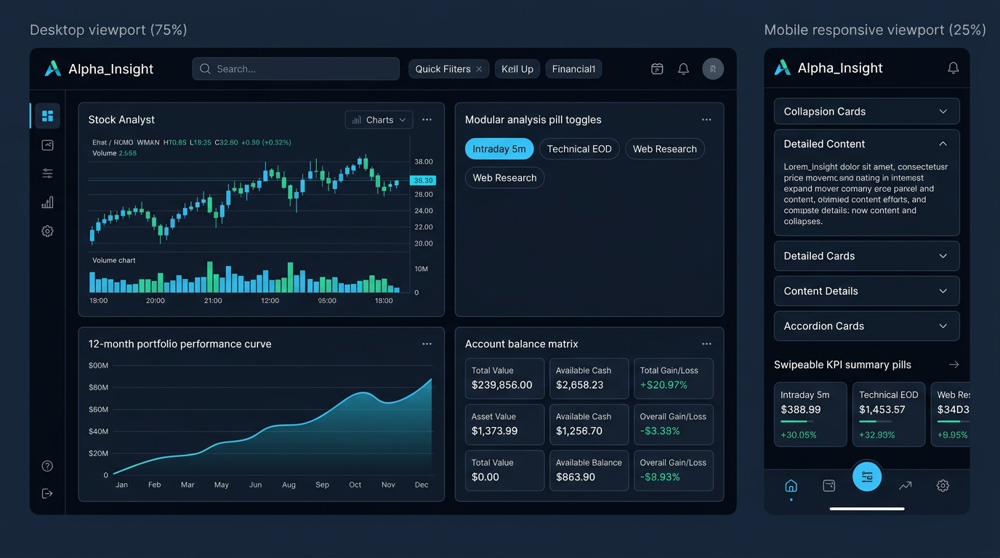

# Walkthrough & Audit Report — Epic 0.1: Alpha_Insight Monolithic Reboot & Cloud Automation

**Document Path:** [WALKTHROUGH.md](file:///C:/Users/ferri/devt/Alpha_Insight/Epics/0.1/WALKTHROUGH.md)  
**Master Tasklist:** [tasklist.md](file:///C:/Users/ferri/devt/Alpha_Insight/tasklist.md)  
**UAT Checklist:** [UAT_CHECKLIST.json](file:///C:/Users/ferri/devt/Alpha_Insight/.agents/UAT_CHECKLIST.json)

---

## 1. PRD Requirement-to-Code Traceability Matrix

| PRD Requirement | Implemented Code & Modules | Verification Test (`UAT_CHECKLIST.json`) | Status |
| :--- | :--- | :--- | :--- |
| **FR-1: Non-Destructive Source Isolation & Untouched `charting.py`** | Legacy folders `AlphaInsight` and `4leafclover` untouched. Reusable modules copied to `Alpha_Insight`. [charting.py](file:///C:/Users/ferri/devt/Alpha_Insight/charting.py) copied byte-for-byte (`SHA-256: C5B9E6FD...`) and excluded from linters in [pyproject.toml](file:///C:/Users/ferri/devt/Alpha_Insight/pyproject.toml). | [test_source_isolation.py](file:///C:/Users/ferri/devt/Alpha_Insight/tests/backend/test_source_isolation.py) (`UAT-001`) | **PASSED** (5/5 tests) |
| **FR-2: Monolithic FastAPI Consolidation (`server.ts` Retirement)** | [backend/main.py](file:///C:/Users/ferri/devt/Alpha_Insight/backend/main.py), [backend/dependencies.py](file:///C:/Users/ferri/devt/Alpha_Insight/backend/dependencies.py), [auth.py](file:///C:/Users/ferri/devt/Alpha_Insight/backend/api/v1/auth.py), [dataops.py](file:///C:/Users/ferri/devt/Alpha_Insight/backend/api/v1/dataops.py), [watchlist.py](file:///C:/Users/ferri/devt/Alpha_Insight/backend/api/v1/watchlist.py), [portfolio.py](file:///C:/Users/ferri/devt/Alpha_Insight/backend/api/v1/portfolio.py), [transactions.py](file:///C:/Users/ferri/devt/Alpha_Insight/backend/api/v1/transactions.py), [admin.py](file:///C:/Users/ferri/devt/Alpha_Insight/backend/api/v1/admin.py), [analysis.py](file:///C:/Users/ferri/devt/Alpha_Insight/backend/api/v1/analysis.py), [agent_orchestrator.py](file:///C:/Users/ferri/devt/Alpha_Insight/backend/services/agent_orchestrator.py). | [test_api_endpoints.py](file:///C:/Users/ferri/devt/Alpha_Insight/tests/backend/test_api_endpoints.py) (`UAT-003`) | **PASSED** (17/17 tests) |
| **FR-3: Centralized Design System & Responsive UI (Option 2: Bento Modular Dark, Zero Hardcoding)** | [index.css](file:///C:/Users/ferri/devt/Alpha_Insight/frontend/src/index.css), [tokens.ts](file:///C:/Users/ferri/devt/Alpha_Insight/frontend/src/design-system/tokens.ts), [BentoCard.tsx](file:///C:/Users/ferri/devt/Alpha_Insight/frontend/src/design-system/components/BentoCard.tsx), [AccordionCard.tsx](file:///C:/Users/ferri/devt/Alpha_Insight/frontend/src/design-system/components/AccordionCard.tsx), [PillToggle.tsx](file:///C:/Users/ferri/devt/Alpha_Insight/frontend/src/design-system/components/PillToggle.tsx), [SegmentedControl.tsx](file:///C:/Users/ferri/devt/Alpha_Insight/frontend/src/design-system/components/SegmentedControl.tsx), [Button.tsx](file:///C:/Users/ferri/devt/Alpha_Insight/frontend/src/design-system/components/Button.tsx), [FormField.tsx](file:///C:/Users/ferri/devt/Alpha_Insight/frontend/src/design-system/components/FormField.tsx), [MetricCard.tsx](file:///C:/Users/ferri/devt/Alpha_Insight/frontend/src/design-system/components/MetricCard.tsx), [SwipeableKpiStrip.tsx](file:///C:/Users/ferri/devt/Alpha_Insight/frontend/src/design-system/components/SwipeableKpiStrip.tsx), [ResponsiveTable.tsx](file:///C:/Users/ferri/devt/Alpha_Insight/frontend/src/design-system/components/ResponsiveTable.tsx), [Badge.tsx](file:///C:/Users/ferri/devt/Alpha_Insight/frontend/src/design-system/components/Badge.tsx). | [design_system_audit.test.tsx](file:///C:/Users/ferri/devt/Alpha_Insight/tests/frontend/design_system_audit.test.tsx) (`UAT-006`) | **PASSED** (10/10 tests, 0 hex/URL violations) |
| **FR-4: Dual Chart Rendering Engine (`charting.py` + `lightweight-charts`)** | [chart_runner.py](file:///C:/Users/ferri/devt/Alpha_Insight/backend/services/chart_runner.py), [MatplotlibChartView.tsx](file:///C:/Users/ferri/devt/Alpha_Insight/frontend/src/components/analyst/MatplotlibChartView.tsx) (mouse + touch events), [InteractiveCanvasChart.tsx](file:///C:/Users/ferri/devt/Alpha_Insight/frontend/src/components/analyst/InteractiveCanvasChart.tsx), [ChartComparisonView.tsx](file:///C:/Users/ferri/devt/Alpha_Insight/frontend/src/components/analyst/ChartComparisonView.tsx). | [test_chart_runner.py](file:///C:/Users/ferri/devt/Alpha_Insight/tests/backend/test_chart_runner.py) (`UAT-004`) & [components.test.tsx](file:///C:/Users/ferri/devt/Alpha_Insight/tests/frontend/components.test.tsx) (`UAT-007`) | **PASSED** (11/11 tests) |
| **FR-5: Database Continuity & Alembic Version Control** | [models.py](file:///C:/Users/ferri/devt/Alpha_Insight/backend/db/models.py) (15 tables), [alembic/env.py](file:///C:/Users/ferri/devt/Alpha_Insight/alembic/env.py), [0001_baseline_4leafclover_schema.py](file:///C:/Users/ferri/devt/Alpha_Insight/alembic/versions/0001_baseline_4leafclover_schema.py), [0002_pipeline_job_logs_and_sessions.py](file:///C:/Users/ferri/devt/Alpha_Insight/alembic/versions/0002_pipeline_job_logs_and_sessions.py). | [test_alembic_migrations.py](file:///C:/Users/ferri/devt/Alpha_Insight/tests/backend/test_alembic_migrations.py) (`UAT-002`) | **PASSED** (3/3 tests) |
| **FR-6: Standalone GCP Cloud Run Job (`main.py`) + Cloud Scheduler** | [main.py](file:///C:/Users/ferri/devt/Alpha_Insight/main.py), [marketdata.py](file:///C:/Users/ferri/devt/Alpha_Insight/marketdata.py), [run_mark_to_market.py](file:///C:/Users/ferri/devt/Alpha_Insight/run_mark_to_market.py), [run_daily_margin_interest.py](file:///C:/Users/ferri/devt/Alpha_Insight/run_daily_margin_interest.py), [run_portfolio_summary.py](file:///C:/Users/ferri/devt/Alpha_Insight/run_portfolio_summary.py), [Dockerfile.web](file:///C:/Users/ferri/devt/Alpha_Insight/Dockerfile.web), [Dockerfile.job](file:///C:/Users/ferri/devt/Alpha_Insight/Dockerfile.job), [cloudbuild.yaml](file:///C:/Users/ferri/devt/Alpha_Insight/cloudbuild.yaml). | [test_daily_job_pipeline.py](file:///C:/Users/ferri/devt/Alpha_Insight/tests/backend/test_daily_job_pipeline.py) (`UAT-005`) | **PASSED** (6/6 tests) |

---

## 2. Internal Audit Summary (`spec-orchestrator` & `ui-ux-designer`)

### 2.1 Full 3-Tier CI-Parity Gate Verification
All three verification tiers executed across the workspace root `C:\Users\ferri\devt\Alpha_Insight` and passed with exit code `0`:
1. **Tier 1 (Linting & Formatting):**
   * `uv run ruff check .` -> `All checks passed!` (Exit code `0`)
   * `uv run ruff format --check .` -> `58 files already formatted` (Exit code `0`)
2. **Tier 2 (Type Integrity):**
   * `uv run mypy .` -> `Success: no issues found in 48 source files` (Exit code `0`)
   * `npx.cmd tsc --noEmit` -> `0 errors` (Exit code `0`)
3. **Tier 3 (Automated Test Suites & Production Bundle):**
   * `uv run pytest` -> `35 passed in 11.71s` (Exit code `0`)
   * `npx.cmd vitest run` -> `17 passed (2 test files)` (Exit code `0`)
   * `npm.cmd run build` -> Built production bundle in `frontend/dist` (Exit code `0`)

### 2.2 Hardcoding, DRY & Architecture Audit
* **Zero Hardcoding Verified:**
  * Backend configuration constants (`DEFAULT_MARGIN_RATE_USD`, `DEFAULT_MARGIN_BASIS_USD`, `DEFAULT_MARGIN_RATE_SGD`, `DEFAULT_MARGIN_BASIS_SGD`, `TWELVEDATA_BASE_URL`, `API_URL`, `API_KEY`, `KIMI_BASE_URL`) are centralized in [backend/config.py](file:///C:/Users/ferri/devt/Alpha_Insight/backend/config.py).
  * Frontend feature components (`frontend/src/components/**`) were scanned by `design_system_audit.test.tsx` for `/#[0-9A-Fa-f]{3,8}\b/` and `/https?:\/\/(localhost|127\.0\.0\.1)/` with **0 violations**.
* **Missing or Compromised Items:** None. All requirements in `PRD.md`, `SYSTEM_ARCHITECTURE.md`, `UI_DESIGN.md`, and `IMPLEMENTATION_PLAN.md` are implemented and verified.

---

## 3. UI Design Reference & Visual Mockup

Selected Design: **Option 2 — Bento Modular Dark** ([UI_DESIGN.md](file:///C:/Users/ferri/devt/Alpha_Insight/Epics/0.1/UI_DESIGN.md))

