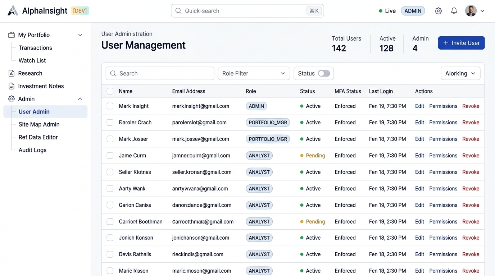
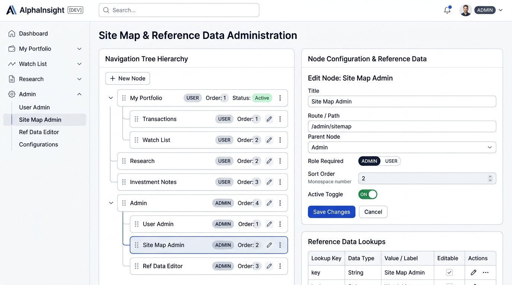
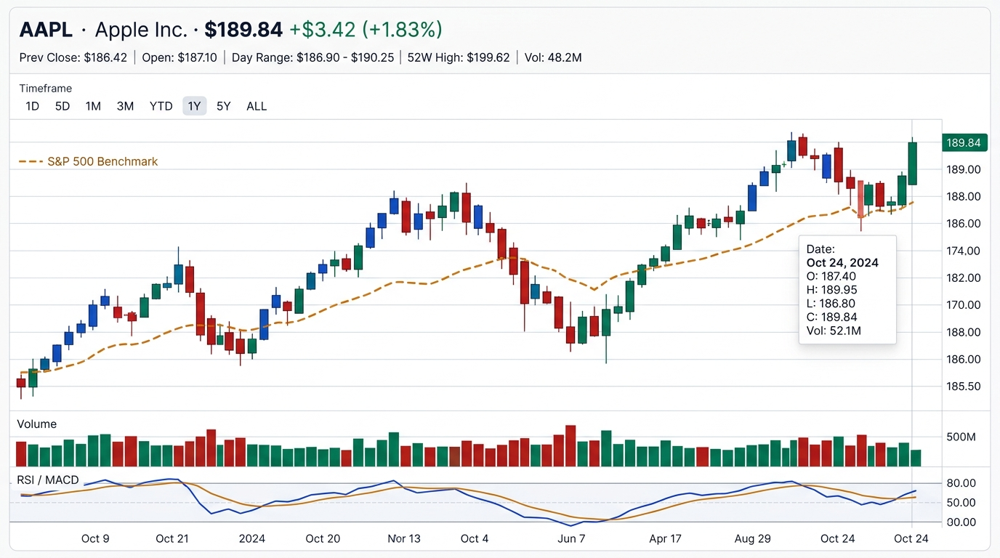

# UI/UX Design Specification — Epic 0.2 (White Paper Aesthetic)
**Project**: Alpha_Insight  
**Epic**: 0.2 — Foundational Database Objects, Dynamic Sitemap Admin, Google OAuth2 RBAC, 100% API Infrastructure & Paper-Based Design System  
**Document Path**: `C:\Users\ferri\devt\Alpha_Insight\Epics\0.2\ui_design.md`  
**Design System Paradigm**: White Paper-Based Design with Clean Printed Lines & High-Contrast Institutional Charting

---

## 1. Visual Mockups & Screen Progression

### 1.1 Desktop Shell & User Administration Interface (16:9 Viewport)
Clean white paper workspace featuring pure white top header with `[DEV]` badge, dynamic left tree sidebar, and high-density User Administration data table with status switches, role pills, and action controls:


---

### 1.2 Site Map Admin & Reference Data Editor (16:9 Viewport)
Dual-column administration layout showing dynamic navigation node tree hierarchy on the left with sort order indices, and node configuration form paired with a Reference Data lookups editor on the right:


---

### 1.3 High-Contrast Financial Chart on White Paper Canvas (16:9 Viewport)
Institutional printed report aesthetic on crisp white paper background with subtle hairline grid lines (`#E2E8F0`), deep cobalt blue & forest emerald bullish candlesticks, sharp carmine red drawdowns, and an amber dashed benchmark line:


---

## 2. White Paper Design System & Token Specifications

The user requirement mandates:
> *"I want the default UI to be white-based, clean lines, just like reading from a paper. High-contrast colors for charts."*

### 2.1 Color Tokens (`DESIGN_TOKENS.paper`)

| Token Category | Token Variable | Hex Value | Semantic Function |
| :--- | :--- | :--- | :--- |
| **Canvas Background** | `paper.canvas` | `#FBFBFC` | Off-white sheet base simulating institutional bond paper |
| **Sheet Surface** | `paper.surface` | `#FFFFFF` | Pure white cards, modals, and data table bodies |
| **Subtle Parchment** | `paper.elevated` | `#F8FAFC` | Table headers, code blocks, input fills |
| **Clean Hair-Line Border** | `paper.border` | `#E2E8F0` | Ultra-crisp `1px` thin dividing borders |
| **Subtle Dividing Rule** | `paper.borderSubtle` | `#F1F5F9` | Secondary table row separators |
| **Active Border / Focus** | `paper.borderActive` | `#2563EB` | Active focus rings, selected menu item indicators |
| **Primary Ink (Text)** | `paper.textPrimary` | `#0F172A` | Deep charcoal black for high-legibility printed text |
| **Secondary Ink** | `paper.textSecondary` | `#334155` | Slate ink for subheaders, labels, metadata |
| **Muted Ink** | `paper.textMuted` | `#64748B` | Footnotes, timestamps, inactive icons |
| **Primary Accent** | `paper.accent` | `#1D4ED8` | Deep cobalt ink for primary actions & brand emphasis |

### 2.2 High-Contrast Chart Tokens (`DESIGN_TOKENS.chartHighContrast`)

| Token Category | Token Variable | Hex / CSS Value | Semantic Role in Charts |
| :--- | :--- | :--- | :--- |
| **Chart Background** | `chart.background` | `#FFFFFF` | Pure white chart canvas |
| **Grid Lines** | `chart.gridColor` | `#E2E8F0` | Ultra-thin `1px` subtle light gray coordinate grid |
| **Bullish Bar / Candlestick** | `chart.upColor` | `#047857` | Deep forest emerald (clean print contrast) |
| **Bullish Stroke / Wick** | `chart.wickUpColor` | `#047857` | High-contrast emerald border |
| **Bearish Bar / Candlestick** | `chart.downColor` | `#B91C1C` | Sharp carmine red |
| **Bearish Stroke / Wick** | `chart.wickDownColor` | `#B91C1C` | High-contrast crimson border |
| **Benchmark Curve** | `chart.benchmark` | `#D97706` | Rich amber dashed overlay (`-- - -`) |
| **Primary Trend (SMA 30)** | `chart.sma30` | `#1D4ED8` | Deep cobalt blue solid line |
| **Secondary Trend (EMA 100)**| `chart.ema100` | `#7C3AED` | Vivid violet solid line |
| **Bollinger Envelope** | `chart.bbBand` | `#0284C7` | Slate blue dashed boundary with subtle wash |
| **Volume Up / Down** | `chart.volumeUp/Down` | `rgba(4, 120, 87, 0.5)` / `rgba(185, 28, 28, 0.5)` | High-density vertical volume bars |

### 2.3 Typography
- **Primary Body & Interface**: `'Aptos'`, `'Segoe UI'`, `-apple-system`, `BlinkMacSystemFont`, `sans-serif` (Default typeface for clean printed page readability).
- **Tabular & Numeric Figures**: `JetBrains Mono`, `'Aptos Mono'`, `ui-monospace`, `monospace` (`font-mono`, `tabular-nums`) to guarantee zero decimal shifting in financial tables.
- **Section Headers & Titles**: `'Aptos Display'`, `'Aptos'`, `'Plus Jakarta Sans'`, `sans-serif` (600/700) with letter spacing `-0.02em`.

---

## 3. Structural Application Frame

```
+----------------------------------------------------------------------------------------------------+
| TOP PANEL: [AlphaInsight Logo] [Env: DEV]                             [Active Role: ADMIN] [Logout] |
+-------------------------------+--------------------------------------------------------------------+
| DYNAMIC LEFT PANEL (Sidebar)  | MAIN WORKSPACE                                                     |
|                               |                                                                    |
| Loaded 100% from `site_map`   | Active View: [Admin > User Admin]                                  |
|                               |                                                                    |
| v My Portfolio                | +----------------------------------------------------------------+ |
|   > Transactions              | | User Directory & Access Control Management                     | |
|     - Investment              | +----------------------------------------------------------------+ |
|     - Capital                 | | [Search Users...]  [Status: All v]  [Role: All v]  [+ Invite]  | |
|     - Trans Cost              | +----------------------------------------------------------------+ |
|   > Watch List                | | Name / Email      | Status   | Roles        | Created    | Act | |
| v Research                    | |-------------------|----------|--------------|------------|-----| |
|   > Stock Analyst             | | Ferris Kwan       | [ACTIVE] | [ADMIN][USER]| 2026-06-18 | [...]| |
|   > Macroeconomics            | | analyst_one@demo  | [ACTIVE] | [ANALYST]    | 2026-08-10 | [...]| |
|   > By Industry/Sector        | | guest_user@demo   | [EXPIRED]| [USER]       | 2026-09-01 | [...]| |
| > Investment Notes            | +----------------------------------------------------------------+ |
| v Admin                       |                                                                    |
|   > User Admin                |                                                                    |
|   > Site Map Admin            |                                                                    |
|   > Ref Data Editor           |                                                                    |
|   > Audit Logs                |                                                                    |
+-------------------------------+--------------------------------------------------------------------+
```

### 3.1 Top Panel (Header Bar)
- **Dimensions**: Fixed height `56px` (`h-14`), full viewport width, pure white background (`#FFFFFF`), bottom border `1px solid #E2E8F0`.
- **Left Cluster**:
  - Clean printed wordmark: `Alpha` (black) `Insight` (cobalt `#1D4ED8`) with an emerald terminal node.
  - Environment badge: `[DEV]` in clean gray pill (`bg-slate-100 text-slate-700 border border-slate-300`).
- **Right Cluster**:
  - Active user identity: User avatar circle, display name, and high-visibility role badge (`ADMIN` in cobalt, `ANALYST` in violet, `USER` in slate).
  - Logout action button with icon and clean border styling.

### 3.2 Dynamic Left Sidebar Menu (100% Driven by `site_map` Table)
- **Data Protocol**:
  - On application mount, frontend calls `GET /api/v1/sitemap`.
  - Backend reads `site_map` rows where `is_active = true`, filters by active user's roles, and returns a sorted nested JSON tree.
- **Visual Styling**:
  - Width `240px`, background `#FFFFFF`, right border `1px solid #E2E8F0`.
  - Nested category expansion: Clean chevron indicators with indented sub-levels (`pl-4`).
  - Active Route Item: Crisp background tint (`#F1F5F9`), deep cobalt typography (`#1D4ED8`), left accent indicator (`3px solid #1D4ED8`).
  - Inactive Route Item: Slate typography (`#334155`), hover background `#F8FAFC`.
- **Responsive Viewports (< 1024px)**:
  - Sidebar collapses off-screen.
  - Bottom bar with `<Menu>` button raises an off-canvas white sheet displaying the exact same dynamic menu tree.

---

## 4. Admin Sub-Applications UIs

### 4.1 User Admin (`/admin/users`)
- **Card Container**: Paper white card with thin hair-line border and zero drop shadow (clean print style).
- **Controls Bar**:
  - Search input for name/email filtering.
  - Role dropdown filter (`All`, `Admin`, `Analyst`, `User`).
  - Status filter (`All`, `Active`, `Expired`).
- **Data Table**:
  - Columns: `User (Name & Avatar)`, `Email`, `Status Badge`, `Assigned Roles`, `Registration Date`, `Access Controls`.
  - Inline Actions:
    - `Make Admin` / `Demote` toggle button.
    - `Activate` / `Expire` toggle button with confirmation dialog.
    - Immediate UI mutation via `POST /api/v1/admin/users/roles` and `POST /api/v1/admin/users/status`.

### 4.2 Site Map Admin (`/admin/sitemap`)
- **Layout**: Two-column master-detail layout:
  - **Left Pane (40%)**: Interactive tree viewer showing current navigation hierarchy loaded from `site_map`. Shows `label`, `menu_code`, `order_index`, and status badge. Includes drag/move up/down controls.
  - **Right Pane (60%)**: Node Editor Form:
    - `Parent Node`: Dropdown selector (Root or existing parent node).
    - `Menu Code`: Unique slug (e.g. `'portfolio.trans_cost'`).
    - `Display Label`: String input (e.g. `'Transaction Cost'`).
    - `Route Path`: String input (e.g. `'/portfolio/transactions/cost'`).
    - `Lucide Icon`: Icon picker or text string (e.g. `'DollarSign'`, `'TrendingUp'`).
    - `Role Required`: Dropdown (`'user'`, `'analyst'`, `'admin'`).
    - `Sort Order`: Integer input.
    - `Is Active`: Toggle switch.
    - Action Buttons: `Save Node`, `Create Sub-item`, `Delete Node`.

### 4.3 Reference Data Editor (`/admin/ref-data`)
- **Table Selector Bar**: Tabs or segmented buttons for editable reference data tables:
  - `sysvalue` (System Parameters)
  - `ref_chart_settings` (Chart Indicator Defaults)
  - `exchange_rate` (Foreign Exchange Rates)
- **Data Grid**:
  - Inline or drawer editing for key-value configuration.
  - Strict type enforcement: Numbers formatted with decimals, dates with calendar pickers, strings with text inputs.
  - `Add Parameter` button and `Save Changes` button dispatching `PUT /api/v1/admin/ref-data/{table}`.

### 4.4 Audit Logs Viewer (`/admin/audit-logs`)
- **Search & Filters**:
  - Filter by Entity (`users`, `site_map`, `sysvalue`, `trades`, `capital`).
  - Filter by Action (`LOGIN`, `UPDATE_ROLE`, `EDIT_REF_DATA`, `DELETE_RECORD`).
  - Date Range picker.
- **Log Table**:
  - Columns: `Timestamp`, `User (Actor)`, `Action`, `Entity`, `Record ID`, `IP Address`, `Details`.
  - Clicking a row expands a clean paper diff box showing:
    - Red strike-through for `old_values`.
    - Green highlight for `new_values`.

---

## 5. Micro-Animations & Interaction Standards

1. **Clean Hair-Line Focus States**:
   - Inputs, buttons, and table rows use sharp `1px` focus rings with zero blur: `outline: 2px solid #2563EB; outline-offset: 1px;`.
2. **Table Row Hover**:
   - Crisp, subtle transition to `#F8FAFC` background over `80ms`. Zero elevation shadows.
3. **Menu Expansion**:
   - Sub-menu trees slide down with smooth height transition (`150ms ease-out`).
4. **Audit Diff Drawer**:
   - Expands inline beneath table rows with `accordion` sliding animation.
