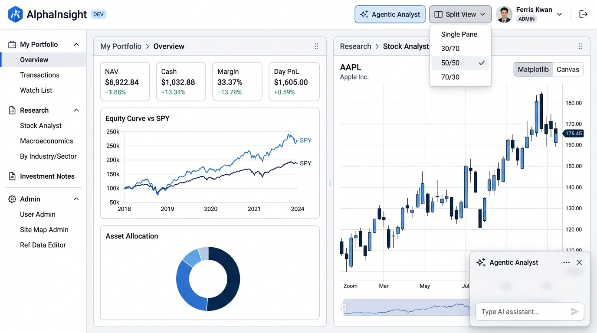
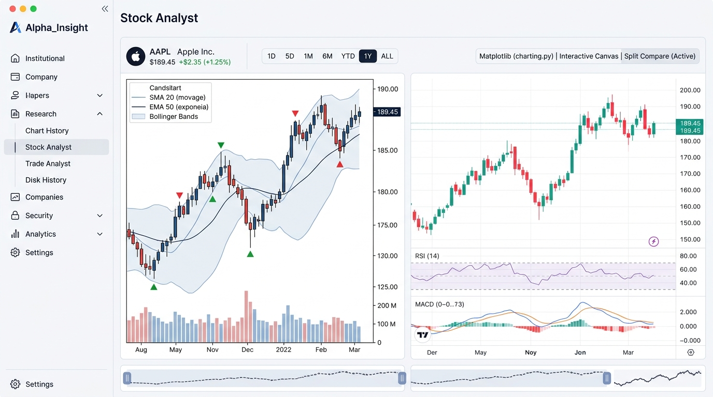
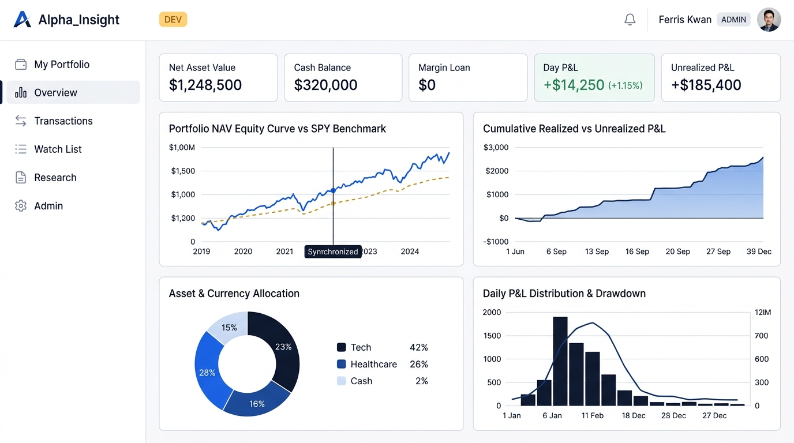
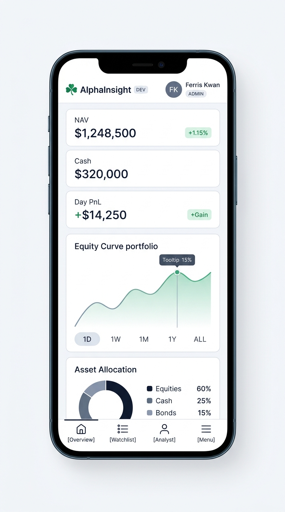

# UI/UX Design Specification — Epic 0.3
**Project**: Alpha_Insight  
**Epic**: 0.3 — My Portfolio & Research Sub-Applications  
**Document Path**: `C:\Users\ferri\devt\Alpha_Insight\Epics\0.3\ui_design.md`  
**Design Paradigm**: Aptos White Paper Institutional Standard with Top-Tier Multi-Application Split-Screen Workspace  

---

## 1. Architectural Wireframe & Visual Mockups

### 1.1 User Architectural Wireframe (Application Shell & Drag-and-Drop Split Concept)
Architectural specification provided by the user establishing top-tier workspace split-screen with drag-and-drop sub-application routing from the left menu:

---

### 1.2 Top-Tier Multi-Application Split-Screen Workspace (16:9 Viewport)
Desktop institutional workspace demonstrating the top-tier `<Split View>` control active at 50/50 ratio, with the left pane hosting `My Portfolio > Overview` and the right pane hosting `Research > Stock Analyst`:

*Key Visual Elements:*
- **Top Panel Header**:
  - `AlphaInsight` institutional branding with `DEV` environment badge.
  - `<Agentic Analyst>` sparkle button trigger for dockable AI assistant.
  - `<Split View>` layout dropdown button with active menu displaying: `Single Pane`, `30/70`, `50/50` (selected), `70/30`.
  - User identity badge: `Ferris Kwan`, `ADMIN` role badge, Logout button.
- **Left Sidebar Menu (Draggable Source)**:
  - Menu items carry drag handles allowing click-and-drag directly into workspace panes.
- **Dual Application Workspace**:
  - **Left Pane (50%)**: Running `My Portfolio > Overview` with top KPI metric cards, NAV equity curve vs SPY, and Asset Allocation donut chart.
  - **Right Pane (50%)**: Running `Research > Stock Analyst` with AAPL status header, 2-way render toggle (`[Matplotlib | Interactive Canvas]`), high-contrast candle chart, and interactive timeline zoom slider.
  - **Floating Panel**: Dockable/floating `Agentic Analyst` card anchored at bottom right.

---

### 1.3 Stock Analyst — 2-Way Render Engine Interface
Deep-dive ticker analysis workbench with simplified 2-mode toggle (`Matplotlib (charting.py)` vs `Interactive Canvas`), removing internal split view in favor of top-tier workspace split:

*Key Visual Elements:*
- **2-Way Segmented Control**: `[Matplotlib (charting.py) | Interactive Canvas]` in the top right toolbar.
- **Clean Single View**: High-precision Matplotlib candle chart with SMA 20, EMA 50, Bollinger Bands shading, Buy/Sell trade execution markers, and volume bars.
- **Timeline Range Slider**: Dual-handle interactive brush slider at the bottom of the workspace.

---

### 1.4 My Portfolio Overview — 4-Chart Synchronized Dashboard
Synchronized 4-panel analytical grid for portfolio health and returns:

---

### 1.5 Mobile Portrait Interface (Slide 2 of `Visualizations.pptx`)
Mobile smartphone viewport (9:16 portrait) adhering strictly to Slide 2 of `Visualizations.pptx`:

*Key Mobile Visual & Architectural Elements:*
- **Split Screen Disabled**: No `<Split View>` control or drag handles exist on mobile devices. Layout is permanently locked to a single column (`Single Pane`).
- **Compact Top Header**: Left AlphaInsight logo and right user avatar (`FK`, `ADMIN` pill) and session actions.
- **Scrollable Single Column**: High-density stacked KPI cards (`NAV`, `Cash`, `Day PnL`), full-width touch-friendly equity curve chart with touch scrubber, and asset allocation breakdown.
- **Fixed Bottom Navigation Bar**: Docked 4-tab bar (`[Overview]`, `[Watchlist]`, `[Analyst]`, `[Menu]`). Tapping `Menu` opens the slide-over drawer exposing all sub-applications (Transactions, Research, Investment Notes, Admin).

---

## 2. White Paper Design System & Token Specifications

Adheres strictly to the **Aptos White Paper Design System** established in Epic 0.2:

### 2.1 Color Palette Tokens (`DESIGN_TOKENS.paper`)

| Token | Hex Value | Purpose |
| :--- | :--- | :--- |
| `paper.canvas` | `#FBFBFC` | Off-white base canvas simulating high-grade bond paper |
| `paper.surface` | `#FFFFFF` | Pure white cards, modal dialogs, data table sheets |
| `paper.elevated` | `#F8FAFC` | Table headers, secondary toolbars, input field fills |
| `paper.border` | `#E2E8F0` | Ultra-crisp `1px` thin dividing borders |
| `paper.borderSubtle` | `#F1F5F9` | Inner table row divider rules |
| `paper.borderActive` | `#2563EB` | Active focus rings, selected menu item accents |
| `paper.textPrimary` | `#0F172A` | Deep charcoal black for primary high-contrast printed text |
| `paper.textSecondary` | `#334155` | Slate ink for subheaders, column headers, metadata |
| `paper.textMuted` | `#64748B` | Footnotes, timestamps, inactive icons |
| `paper.accent` | `#1D4ED8` | Deep cobalt ink for primary actions & brand buttons |

### 2.2 High-Contrast Financial Visualizations (`DESIGN_TOKENS.chartHighContrast`)

| Chart Element | Hex / CSS Value | Role in Financial Charts |
| :--- | :--- | :--- |
| `chart.background` | `#FFFFFF` | Pure white chart canvas |
| `chart.gridColor` | `#E2E8F0` | Ultra-thin `1px` coordinate grid lines |
| `chart.upColor` (Bullish) | `#047857` | Deep forest emerald |
| `chart.downColor` (Bearish)| `#B91C1C` | Sharp carmine red |
| `chart.benchmark` | `#D97706` | Amber dashed benchmark curve (`-- - -`) |
| `chart.primaryLine` | `#1D4ED8` | Deep cobalt blue equity curve & SMA lines |
| `chart.secondaryLine` | `#7C3AED` | Vivid violet EMA line |
| `chart.bandFill` | `rgba(2, 132, 199, 0.08)` | Subtle light blue wash between Bollinger Bands |
| `chart.volumeBars` | `rgba(4, 120, 87, 0.5)` / `rgba(185, 28, 28, 0.5)` | High-density vertical volume histogram |

---

## 3. Top-Tier Multi-Application Split-Screen Ergonomics

### 3.1 Layout Modes (`layoutMode`)
The application frame supports 4 discrete layout modes toggled via the `<Split View>` control in the Top Panel:
1. **`single` (100%)**: Default single-app view occupying the full main workspace.
2. **`split-30-70`**: Left Pane 30% width (ideal for Watchlist / Quick Overview) and Right Pane 70% width (ideal for Stock Analyst deep dive).
3. **`split-50-50`**: Symmetrical 50% / 50% split view for equal side-by-side comparison.
4. **`split-70-30`**: Left Pane 70% width and Right Pane 30% width.

### 3.2 Drag-and-Drop Interaction Mechanics
- **Draggable Menu Nodes**:
  - Every leaf navigation item in `DynamicSidebar.tsx` has `draggable={true}`.
  - On `dragstart`, serializes `{ menuCode: item.menu_code, label: item.label, route: item.route }` into `event.dataTransfer`.
- **Drop Target Panes**:
  - Both Left Pane and Right Pane implement HTML5 drop handlers (`onDragOver`, `onDragLeave`, `onDrop`).
  - During dragover, an active pane displays a translucent dashed outline with a subtle blue pill: *"Drop to load in Left Pane"* / *"Drop to load in Right Pane"*.
  - On drop, the target pane updates its route and mounts the dropped application immediately.
- **Focused Pane Direct Click Routing**:
  - Clicking an item in the sidebar without dragging loads the application into whichever pane currently has active focus (highlighted with a subtle 2px accent top border on the pane header).

### 3.3 Mobile Responsive Layout Separation (`< 1024px`)
Strictly enforcing the mobile specifications from Slide 2 of `Visualizations.pptx`:
- **Split Screen Suppression**: The `<Split View>` control is hidden on mobile viewports (`hidden lg:flex`). Layout forcibly resets and locks to `Single Pane` (100% width).
- **Drag-and-Drop Deactivation**: HTML5 drag-and-drop handles and drop zones are disabled on mobile devices; standard touch tap navigation is used.
- **Fixed Bottom Navigation Bar**:
  - Docked fixed to the bottom of the viewport: `fixed bottom-0 left-0 right-0 h-16 bg-white border-t border-slate-200 z-40 flex items-center justify-around`.
  - 4 Touch Tabs: `[Overview]`, `[Watchlist]`, `[Analyst]`, `[Menu]`.
  - Tapping `[Menu]` slides in the full mobile drawer to access Transactions, Research, Investment Notes, and Admin.
- **Scroll Padding**: Workspace contents have `pb-20` on mobile viewports to prevent bottom navigation bar overlap.
- **Single-Column Responsive Stacking**: All multi-column cards, 4-chart grids, and KPI summary strips collapse to a clean single column (`grid-cols-1`).

---

## 4. Typography & Monospace Numbers

- **Body & Controls**: `'Aptos'`, `'Segoe UI'`, `-apple-system`, `sans-serif`.
- **Tabular Figures & Monetary Values**: `JetBrains Mono`, `'Aptos Mono'`, `monospace` (`font-mono`, `tabular-nums`) to guarantee zero horizontal shifting.
- **Headers**: `'Aptos Display'`, `'Aptos'`, `sans-serif` (600/700 weight, letter-spacing `-0.02em`).

---

## 5. Micro-Animations & Interactive Feedback

- **Crosshair Synchronization**: Vertical hairline indicator tracking across all linked charts with zero lag (`requestAnimationFrame`).
- **Pane Resizing & Transitions**: Smooth layout grid transitions (`transition-all duration-200 ease-in-out`).
- **Drop Zone Pulse**: Subtle pulse animation on drag target panes (`animate-pulse border-blue-400 bg-blue-50/20`).
- **Floating Panel Docking**: Slide-up & fade transition for Agentic Analyst floating assistant.

---

## 6. Accessibility & Contrast (WCAG 2.1 AA)

- All text meets or exceeds WCAG 2.1 AA contrast ratio of 4.5:1 against `#FFFFFF` / `#FBFBFC`.
- Drag-and-drop operations provide accessible keyboard alternatives: A pane target selector in each sub-application header allows sending an app to "Left Pane" or "Right Pane" via keyboard.

---

## 7. Design System Architecture & Zero-Hardcoding Mandate

To maintain strict architectural cleanliness, prevent visual inconsistency, and eliminate duplicate markup across screens:
1. **Zero Component Duplication**: Sub-applications (`Overview`, `Transactions`, `WatchList`, `StockAnalyst`, `Macroeconomics`, `ByIndustrySector`) MUST compose reusable components from `frontend/src/design-system/`. Direct inline HTML/Tailwind constructions of custom cards, raw buttons, one-off modal shells, or bespoke split-pane containers are strictly forbidden.
2. **Centralized Component Additions**:
   - `frontend/src/design-system/components/SplitPaneLayout.tsx`: Workstation shell component governing `single`, `30/70`, `50/50`, `70/30` splits, HTML5 drag-and-drop zone events, and active pane borders.
   - `frontend/src/design-system/components/BottomNavBar.tsx`: Mobile fixed bottom navigation bar component supporting 4 standard touch tabs and menu slide-over drawer.
   - `frontend/src/design-system/components/ChartContainer.tsx`: Standardized white paper card wrapper for all financial charts, providing Aptos headers, time-range pill selectors, and synchronized crosshair events.
   - `frontend/src/design-system/components/ModalDialog.tsx`: Reusable white paper modal dialog for Buy/Sell trade tickets, symbol additions, and parameter edits with accessibility focus trapping.
   - `frontend/src/design-system/components/HeatmapGrid.tsx`: Standardized performance heatmap matrix component utilizing token-driven color ramps.
3. **Token Sourcing**: All colors, line weights, font families, and radii must reference `DESIGN_TOKENS` from `frontend/src/design-system/tokens.ts`. No raw hex codes or magic numbers may appear in sub-application code.
