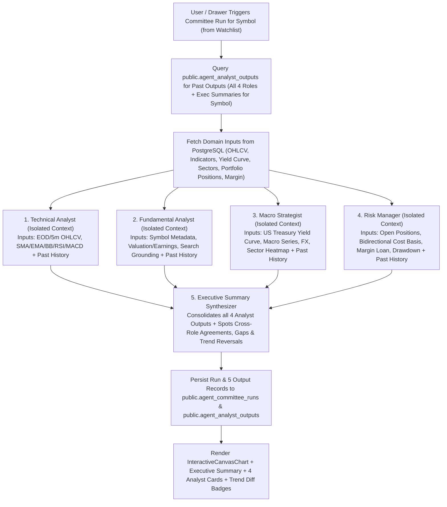

# Product Requirements Document (PRD) — Epic 0.4

**Project**: Alpha_Insight  
**Epic**: 0.4 — Autonomous Analyst Committee, Historical Agent Output Storage & Investment Notes  
**Database Instance**: `gen-lang-client-0632004807:asia-southeast1:clover` (`4leafclover_dev`)  
**Document Path**: `C:\Users\ferri\devt\Alpha_Insight\Epics\0.4\PRD.md`  
**Classification**: `[SCOPE: MAJOR_ARCHITECTURAL]`  

---

## 1. Execution Priority & Scope Summary

Epic 0.4 is structured in two sequential workstreams, executing **(2) Agentic Intelligence & Multi-Agent Committee** first, followed by **(1) Investment Notes Sub-Application**:

1. **Priority 1 — Workstream (2): Autonomous Analyst Agents, Historical Output Database & Executive Summary**
   - **LLM Engine**: Default model set to `gemini-4-argon` via Google GenAI API, with runtime selector supporting `gemini-4-argon`, `gemini-4-carbon`, `gemini-4-hydrogen`, `gemini-3.8-flash`, `gemini-2.5-pro`, `gemini-2.5-flash`, and Moonshot `kimi-k2-0711-preview`.
   - **Segregated 4-Analyst Architecture**: Four independent specialist agents (`technical`, `fundamental`, `macro`, `risk`) execute concurrently in isolated prompt contexts during a live run so their active evaluations and recommendations do not bias one another.
   - **Executive Summary Synthesizer**: A 5th consolidation step runs after all 4 specialists finish, aggregating their 4 outputs into a succinct Executive Summary, consensus directional bias (`Bullish`, `Bearish`, `Neutral`), voting breakdown, and cross-disciplinary divergence summary.
   - **Historical Analyst Output Storage & Trend/Reversal Lookup**: New PostgreSQL tables (`agent_committee_runs` and `agent_analyst_outputs`) persist every specialist output and Executive Summary. On subsequent runs for a symbol, each analyst queries prior stored outputs across all 4 analyst roles for that symbol to detect trend continuations, trend reversals, and thesis gaps.
   - **Interactive Canvas Charting**: The Autonomous Analyst Committee workspace (`/research/committee`) renders price action, technical indicators (SMA, EMA, Bollinger Bands, RSI, MACD, Fibonacci), and trade markers using the client-side `InteractiveCanvasChart` (`lightweight-charts`) component.
   - **Dual UI Surface, Componentized Agentic Outputs & Floating Chat Session**:
     - Under the **`[Research]`** menu (`public.site_map`), `"By Industry/Sector"` is permanently removed; `[Research]` contains **`Stock Analysis`** (`/research/committee`) and **`Macroeconomics`** (`/research/macro`).
     - All agentic outputs (`Exec Summary`, `Technical`, `Fundamental`, `Macro`, `Risk Mgt`) are componentized into a reusable design-system component (`AnalystOutputPanel` in `frontend/src/design-system/components/AnalystOutputPanel.tsx`) so the `Macro` component is rendered in **both** `[Macroeconomics]` and `[Stock Analysis]`.
     - **`[Macroeconomics]` Overhaul (`/research/macro`)**: Replaces the legacy hardcoded page with:
       1. **Benchmark Index `InteractiveCanvasChart`** (`^SPX`, `^NDX`, `^DJI`, `^STI`, `SOXX`, `IBIT` from `public.watchlist`) with `[Multi-day (6M Default) | Intraday (5m)]` toggle and live FX from `public.exchange_rate`.
       2. **Watchlist-Derived 3-Tab Macro Strategist (`Global & US Macro`, `SG & Asia-Pacific Macro`, `Secular & Geopolitics`)**: Scope is dynamically derived from the user's symbols in `public.watchlist`.
       3. **Zero-Hallucination Citation & Source Grounding**: Enforces Google Search Grounding (`google_search` tool) and requires inline citations + verified source links (`grounding_links`) stored in `public.agent_analyst_outputs` (`structured_metrics.grounding_links`).
       4. **Cross-App Macro Persistence**: Macro outputs are saved in `public.agent_analyst_outputs` so `[Stock Analysis]` automatically pulls the latest stored Macro regime into its `Macro` tab and `Exec Summary`, and `[Investment Notes]` can link `0..N` Macro outputs.
     - Selecting **`[Chat Session]`** in the top header launches a resizable **floating interactive chat window** (`FloatingAgentChat` in `frontend/src/design-system/`) backed by `public.agent_chat_messages` (`POST /api/v1/committee/chat`, `GET /api/v1/committee/chat/history`) tied to the active analysis run.

2. **Priority 2 — Workstream (1): Investment Notes Sub-Application & Relational Entity Linking**
   - **Watchlist-Sourced Ticker Linking**: Ticker symbols selectable in Investment Notes are populated directly from the `public.watchlist` table.
   - **0-to-Multiple Agent Output Linking**: Each Investment Note can link between `0` and `N` records from `agent_analyst_outputs`, allowing the user to attach individual specialist outputs (e.g., Technical or Risk), the consolidated Executive Summary, or multiple outputs across different dates.
   - **Trade & Thesis Tracking**: Optional linking to executed trades (`public.trade.id`), Markdown editor with KaTeX math support, tag management, full-text search, symbol/date filtering, and thesis status tracking (`In-Progress`, `Validated`, `Invalidated`).

---

## 2. Current State Analysis & Architecture Alignment

| Component | Current State in `Alpha_Insight` | Epic 0.4 Target State |
| :--- | :--- | :--- |
| **LLM Provider & Model (`backend/config.py`)** | `GEMINI_DEFAULT_MODEL` defaults to `gemini-2.5-flash`; `google.genai` client uses default `httpx` SSL context which fails certificate verification on local Windows Python 3.14. | Update `GEMINI_DEFAULT_MODEL` to `gemini-4-argon`. Configure `google.genai` `HttpOptions` with SSL fallback handling so live `gemini-4-argon` calls succeed. Expose selectable models in UI and `sysvalue`. |
| **Analysis Service (`backend/services/agent_orchestrator.py`)** | Single-prompt `run_stock_analysis()` returning unpersisted markdown. | Add `run_committee_analysis()` executing 4 segregated analyst prompts concurrently (`asyncio.gather`), querying historical outputs from PostgreSQL, running the Executive Summary synthesizer, and persisting all records. |
| **Database Schema (`backend/db/models.py`)** | 17 tables in `4leafclover_dev` (Alembic revision `0004`). No tables for analyst outputs or investment notes. | Alembic revision `0005` adding `agent_committee_runs`, `agent_analyst_outputs`, `investment_notes`, and `investment_note_analyst_links`, plus seeding `/research/committee` into `site_map`. |
| **Charting in Analyst Views (`InteractiveCanvasChart.tsx`)** | `InteractiveCanvasChart` (`lightweight-charts`) exists in `frontend/src/components/analyst/InteractiveCanvasChart.tsx`. | Embed `InteractiveCanvasChart` directly inside `/research/committee` so users inspect live candles and indicators alongside the 4 analyst reports. |
| **Investment Notes UI (`ScaffoldViews.tsx`)** | Static placeholder card at `/notes`. | Replace with production `InvestmentNotesView.tsx` backed by `/api/v1/notes` CRUD endpoints, watchlist symbol selector, and `0..N` analyst output reference picker. |
| **Agentic Analyst Drawer (`AppShell.tsx`)** | Static hardcoded drawer in `AppShell.tsx`. | Connect drawer to live `/api/v1/committee` endpoints to trigger committee runs, display the latest Executive Summary & 4-agent votes, and open full view in `/research/committee`. |

---

## 3. Functional & Technical Specifications

### 3.1 Segregated 4-Analyst Committee & Executive Summary (Workstream 2)

1. **Unbiased Concurrent Execution & Prompt Architecture (referencing `C:\Users\ferri\OneDrive\Documents\AlphaInsight\src\lib\promptBuilder.ts`)**:
   - The 4 analysts (`technical`, `fundamental`, `macro`, `risk`) are invoked in parallel via `asyncio.gather`.
   - During the live execution of a run, no analyst receives the prompt or live output of any other analyst in the same run.
   - Each specialist prompt expands upon the baseline modules in `C:\Users\ferri\OneDrive\Documents\AlphaInsight\src\lib\promptBuilder.ts`:
     - **Technical Analyst**: Incorporates Group 1 (Intraday Microstructure: 5m ATR vs friction, liquidity consistency, volatility regime, VWAP anchoring, math candle breakouts/pin bars) and Group 2 (Classical geometric patterns, Bollinger Bands/RSI mean reversion, MACD/EMA trend alignment, Fibonacci retracement table `23.6%`–`78.6%`), expanded with multi-timeframe divergence and key structural support/resistance levels.
     - **Fundamental Analyst**: Incorporates Group 3 (`newsScan` 7-day catalyst scan with Google Search grounding) and expands it with earnings/revenue revision analysis, valuation multiples (P/E, EV/EBITDA, P/FCF), balance sheet leverage, and margin durability.
     - **Macro Strategist**: Incorporates Group 3 (`secularIndustry` secular and regulatory drivers) and expands it with US Treasury yield curve structure (`1M`–`30Y`, `10Y-2Y` spread), central bank rate cycle, inflation/growth regime, FX cross-rate sensitivity, and 11 GICS sector relative rotation.
     - **Risk Manager**: Evaluates bidirectional position exposure (`Long`/`Short` net open quantity and average cost basis), portfolio concentration weight, margin loan utilization and daily interest accrual, high-water mark drawdown impact, transaction cost friction, and ATR-based stop-loss / position sizing boundaries.
2. **Cross-Role Historical Context Injection**:
   - Prior to invoking the 4 analysts for `symbol`, the backend queries `agent_analyst_outputs` for the last $K$ (default $K = 3$ runs, up to 15 output records covering `technical`, `fundamental`, `macro`, `risk`, and `executive_summary`) ordered by `created_at DESC`.
   - Each analyst receives this historical ledger and is instructed to explicitly report:
     - **Trend Status**: `Trend Continuation`, `Trend Reversal`, `New Initiation`, or `Thesis Gap`.
     - **Delta Summary**: How current metrics and directional bias compare against prior recorded outputs across the 4 roles.
3. **Structured Output Contract per Analyst**:
   - `analyst_role`: `'technical' | 'fundamental' | 'macro' | 'risk' | 'executive_summary'`
   - `directional_bias`: `'Bullish' | 'Bearish' | 'Neutral'`
   - `confidence_score`: Integer `0` to `100`
   - `trend_status`: `'Continuation' | 'Reversal' | 'Initiation' | 'Gap'`
   - `summary_headline`: Single-sentence operational conclusion (max 240 chars)
   - `markdown_report`: Structured findings, metrics table, and historical comparison notes
   - `structured_metrics`: JSON object storing role-specific key-value metrics (e.g., support/resistance levels, stop-loss price, position size limit, yield spread)
4. **Executive Summary Consolidation**:
   - Receives the completed outputs of all 4 analysts from the current run plus historical context.
   - Produces a succinct Executive Summary containing:
     - Consolidated Directional Bias (`Bullish`, `Bearish`, `Neutral`) and consensus vote count (e.g., `3 Bullish / 1 Neutral`).
     - Succinct synthesis of the 4 analysts' core conclusions.
     - Cross-analyst conflicts, risk caveats, and historical trend shifts.

### 3.2 Database Schema Specifications (Alembic Revision `0005`)

#### Table 1: `public.agent_committee_runs`
Groups a single invocation of the 4-analyst committee and its Executive Summary.

| Column | Type | Constraints | Description |
| :--- | :--- | :--- | :--- |
| `id` | `INTEGER` | `PRIMARY KEY, AUTOINCREMENT` | Unique run identifier |
| `user_id` | `INTEGER` | `FOREIGN KEY (users.id), NOT NULL, INDEX` | User who initiated the run |
| `symbol` | `VARCHAR(32)` | `NOT NULL, INDEX` | Target ticker symbol (from `watchlist`) |
| `provider` | `VARCHAR(32)` | `NOT NULL, DEFAULT 'gemini'` | AI provider (`gemini` or `kimi`) |
| `model` | `VARCHAR(64)` | `NOT NULL, DEFAULT 'gemini-4-argon'` | Model identifier used |
| `consensus_bias` | `VARCHAR(16)` | `NOT NULL` | Consolidated bias (`Bullish`, `Bearish`, `Neutral`) |
| `consensus_confidence` | `INTEGER` | `NOT NULL, DEFAULT 50` | Consolidated confidence (`0`-`100`) |
| `executive_summary` | `TEXT` | `NOT NULL` | Consolidated Executive Summary markdown |
| `vote_breakdown` | `JSON` | `NULLABLE` | Votes per role (`{"technical": "Bullish", ...}`) |
| `created_at` | `TIMESTAMPTZ` | `NOT NULL, DEFAULT CURRENT_TIMESTAMP, INDEX` | Execution timestamp |

#### Table 2: `public.agent_analyst_outputs`
Stores individual outputs for each of the 4 segregated analysts and the `executive_summary` record so future agentic runs and Investment Notes can reference specific outputs.

| Column | Type | Constraints | Description |
| :--- | :--- | :--- | :--- |
| `id` | `INTEGER` | `PRIMARY KEY, AUTOINCREMENT` | Unique analyst output ID |
| `run_id` | `INTEGER` | `FOREIGN KEY (agent_committee_runs.id ON DELETE CASCADE), NOT NULL, INDEX` | Parent committee run ID |
| `user_id` | `INTEGER` | `FOREIGN KEY (users.id), NOT NULL, INDEX` | User ID |
| `symbol` | `VARCHAR(32)` | `NOT NULL, INDEX` | Target ticker symbol |
| `analyst_role` | `VARCHAR(32)` | `NOT NULL, INDEX` | `'technical'`, `'fundamental'`, `'macro'`, `'risk'`, or `'executive_summary'` |
| `directional_bias` | `VARCHAR(16)` | `NOT NULL` | `'Bullish'`, `'Bearish'`, or `'Neutral'` |
| `confidence_score` | `INTEGER` | `NOT NULL, DEFAULT 50` | Score from `0` to `100` |
| `trend_status` | `VARCHAR(32)` | `NOT NULL, DEFAULT 'Initiation'` | `'Continuation'`, `'Reversal'`, `'Initiation'`, `'Gap'` |
| `summary_headline` | `VARCHAR(255)` | `NOT NULL` | Concise 1-line summary for picker lists & cards |
| `markdown_output` | `TEXT` | `NOT NULL` | Full analyst report in Markdown |
| `structured_metrics` | `JSON` | `NULLABLE` | Role-specific quantitative metrics and chart levels |
| `referenced_output_ids` | `JSON` | `NULLABLE` | Array of past `agent_analyst_outputs.id` referenced |
| `created_at` | `TIMESTAMPTZ` | `NOT NULL, DEFAULT CURRENT_TIMESTAMP, INDEX` | Creation timestamp |

#### Table 3: `public.investment_notes`
Stores user investment notes, linked to watchlist ticker symbols and optional executed trades.

| Column | Type | Constraints | Description |
| :--- | :--- | :--- | :--- |
| `id` | `INTEGER` | `PRIMARY KEY, AUTOINCREMENT` | Unique note ID |
| `user_id` | `INTEGER` | `FOREIGN KEY (users.id), NOT NULL, INDEX` | Author user ID |
| `symbol` | `VARCHAR(32)` | `NOT NULL, INDEX` | Ticker symbol selected from `public.watchlist` |
| `trade_id` | `INTEGER` | `FOREIGN KEY (trade.id ON DELETE SET NULL), NULLABLE, INDEX` | Optional link to a specific executed trade |
| `title` | `VARCHAR(255)` | `NOT NULL` | Note title |
| `content_markdown` | `TEXT` | `NOT NULL` | Rich Markdown body (supports KaTeX math) |
| `thesis_status` | `VARCHAR(32)` | `NOT NULL, DEFAULT 'In-Progress', INDEX` | `'In-Progress'`, `'Validated'`, `'Invalidated'` |
| `tags` | `JSON` | `NULLABLE` | String array of tags (e.g., `["Earnings", "Breakout"]`) |
| `created_at` | `TIMESTAMPTZ` | `NOT NULL, DEFAULT CURRENT_TIMESTAMP, INDEX` | Creation timestamp |
| `updated_at` | `TIMESTAMPTZ` | `NOT NULL, DEFAULT CURRENT_TIMESTAMP` | Last update timestamp |

#### Table 4: `public.investment_note_analyst_links`
Associative table enabling a single Investment Note to reference between `0` and `N` outputs from `public.agent_analyst_outputs` (individual analyst outputs and/or Executive Summaries).

| Column | Type | Constraints | Description |
| :--- | :--- | :--- | :--- |
| `id` | `INTEGER` | `PRIMARY KEY, AUTOINCREMENT` | Unique link ID |
| `note_id` | `INTEGER` | `FOREIGN KEY (investment_notes.id ON DELETE CASCADE), NOT NULL, INDEX` | Investment note ID |
| `analyst_output_id` | `INTEGER` | `FOREIGN KEY (agent_analyst_outputs.id ON DELETE CASCADE), NOT NULL, INDEX` | Referenced analyst output ID |
| `created_at` | `TIMESTAMPTZ` | `NOT NULL, DEFAULT CURRENT_TIMESTAMP` | Link timestamp |

*Unique Constraint*: `uq_note_analyst_output (note_id, analyst_output_id)` to prevent duplicate links on the same note.

---

## 4. REST API Endpoint Specifications

All endpoints use Pydantic v2 schemas and log mutations to `public.audit_log`.

| Endpoint Path | Method | Roles | Request / Query Params | Description |
| :--- | :--- | :--- | :--- | :--- |
| `/api/v1/committee/run` | `POST` | `user`, `analyst`, `admin` | `CommitteeRunRequest` (`symbol`, `provider`, `model`, `lookback_runs`) | Executes the 4 segregated analysts + Executive Summary, links past history, persists to DB, and returns the complete run. |
| `/api/v1/committee/runs` | `GET` | `user`, `analyst`, `admin` | `symbol`, `limit` | Lists historical committee runs and Executive Summaries (filtered by symbol if provided). |
| `/api/v1/committee/runs/{run_id}` | `GET` | `user`, `analyst`, `admin` | `run_id` | Returns a specific committee run including all 5 `agent_analyst_outputs` records and OHLCV chart series for `InteractiveCanvasChart`. |
| `/api/v1/committee/outputs` | `GET` | `user`, `analyst`, `admin` | `symbol`, `analyst_role`, `trend_status`, `limit` | Queries individual `agent_analyst_outputs` rows for historical inspection and for the Investment Notes reference selector (`0..N`). |
| `/api/v1/committee/models` | `GET` | `user`, `analyst`, `admin` | None | Returns available AI providers and models (`gemini-4-argon` default, etc.). |
| `/api/v1/committee/macro/run` | `POST` | `user`, `analyst`, `admin` | `MacroAnalysisRunRequest` (`benchmark_symbol`, `provider`, `model`, `lookback_runs`) | Executes the Watchlist-derived 3-tab Macro Strategist (`Global & US`, `SG & Asia-Pacific`, `Secular & Geopolitics`) with mandatory Google Search grounding & citations, persists to `agent_analyst_outputs`, and returns the run. |
| `/api/v1/committee/macro/latest` | `GET` | `user`, `analyst`, `admin` | `benchmark_symbol` | Returns the latest stored 3-tab Macro Strategist run, verified citations, watchlist exposure summary, live `exchange_rate` FX crosses, and benchmark index candles. |
| `/api/v1/committee/chat` | `POST` | `user`, `analyst`, `admin` | `AgentContextualChatRequest` (`messages`, `symbol`, `run_id`, `active_route`, `displayed_context`, `provider`, `model`) | Interactive multi-turn chat endpoint powering the resizable `[Chat Session]` window with DB persistence in `public.agent_chat_messages`. |
| `/api/v1/committee/chat/history` | `GET`, `DELETE` | `user`, `analyst`, `admin` | `symbol`, `run_id` | Retrieves or clears persisted chat session messages tied to an analysis run. |
| `/api/v1/notes` | `GET` | `user`, `analyst`, `admin` | `symbol`, `thesis_status`, `search`, `tag`, `limit` | Lists Investment Notes with their linked `0..N` `agent_analyst_outputs` summaries and optional linked `trade` metadata. |
| `/api/v1/notes` | `POST` | `user`, `analyst`, `admin` | `InvestmentNoteCreate` (`symbol`, `trade_id`, `title`, `content_markdown`, `thesis_status`, `tags`, `analyst_output_ids: list[int]`) | Validates `symbol` against `public.watchlist`, creates the note, and attaches `0..N` analyst outputs in `investment_note_analyst_links`. |
| `/api/v1/notes/{note_id}` | `PUT` | `user`, `analyst`, `admin` | `InvestmentNoteUpdate` | Updates note content, status, watchlist symbol, trade link, and reconciles the `0..N` linked `analyst_output_ids`. |
| `/api/v1/notes/{note_id}` | `DELETE` | `user`, `analyst`, `admin` | `note_id` | Deletes the note and cascades link cleanup, recording an audit log entry. |

---

## 5. UI/UX & Design System Specifications

Adheres to the established **Aptos White Paper Design System** (`frontend/src/design-system/`):

1. **Autonomous Analyst Committee View (`/research/committee`)**:
   - **Header Controls**: Watchlist symbol dropdown (sourced from `public.watchlist`), Model selector defaulting to `gemini-4-argon`, historical lookback depth selector, and `Run Committee Analysis` primary button.
   - **Interactive Canvas Chart Panel**: Renders `InteractiveCanvasChart` (`lightweight-charts`) inside a `ChartContainer` card with candlesticks, SMA 30, EMA 100, Bollinger Bands, RSI, MACD, and trade execution markers.
   - **Executive Summary Banner**: White paper card displaying the consolidated Executive Summary, consensus directional badge (`Bullish` in emerald `#047857`, `Bearish` in carmine `#B91C1C`, `Neutral` in slate `#475569`), confidence meter, 4-analyst voting pills, and historical trend status badge (`Continuation`, `Reversal`, `Initiation`, `Gap`).
   - **4-Analyst Segregated Grid**: 4 structured cards (`Technical Analyst`, `Fundamental Analyst`, `Macro Strategist`, `Risk Manager`) showing each agent's independent directional bias, confidence score, trend status vs past outputs, key metrics, expandable Markdown report, and a quick button `"Reference in Note"`.
   - **Historical Output Timeline**: Table/timeline below the grid listing past analyst outputs for the selected symbol to compare how recommendations evolved over time.
2. **Right-Hand Dockable `Agentic Analyst` Drawer (`AppShell.tsx`)**:
   - Displays the latest Executive Summary and 4-analyst vote pills for the currently active symbol.
   - Provides a 1-click `"Run 4-Analyst Committee"` button and `"Open Full Committee Workspace"` navigation trigger.
3. **Investment Notes Sub-Application (`/notes`)**:
   - **Watchlist Symbol Selector**: Dropdown populated exclusively from the user's `public.watchlist` symbols.
   - **Agent Output Reference Picker (`0..N`)**: Multi-select modal/drawer allowing the user to filter `agent_analyst_outputs` by symbol and role (`Executive Summary`, `Technical`, `Fundamental`, `Macro`, `Risk`) and attach `0`, `1`, or multiple outputs to the note.
   - **Referenced Outputs Strip**: Displays attached analyst output chips/cards inside the note viewer/editor; clicking a chip expands the full historical snapshot of that analyst output.
   - **Filter & Audit Bar**: Filter notes by Watchlist symbol, thesis status (`In-Progress`, `Validated`, `Invalidated`), linked analyst role, or full-text search query.

---

## 6. Success Criteria Matrix

| ID | Category | Requirement / Success Criteria | Verification Method |
| :--- | :--- | :--- | :--- |
| **SC-01** | Default Agent Model | Backend defaults to `gemini-4-argon` and exposes selectable model list via `/api/v1/committee/models`. | Pytest config & endpoint assertion. |
| **SC-02** | Segregated 4-Analyst Execution | `Technical`, `Fundamental`, `Macro`, and `Risk` agents run concurrently with isolated prompts and domain inputs without sharing current-run outputs. | Pytest orchestrator unit test verifying prompt isolation. |
| **SC-03** | Executive Summary Consolidation | Synthesizer step runs after the 4 analysts and produces a succinct Executive Summary, consensus bias, and vote breakdown. | Pytest committee run schema & synthesis test. |
| **SC-04** | Historical Output DB Storage & Lookup | `agent_committee_runs` and `agent_analyst_outputs` persist all runs; subsequent runs for the same symbol inject past outputs from all 4 roles to classify trend continuations, reversals, or gaps. | Pytest database persistence & multi-run trend lookup test. |
| **SC-05** | Interactive Canvas Graphing | Committee view renders price and indicator charts exclusively via `InteractiveCanvasChart` (`lightweight-charts`). | Vitest component render & props assertion. |
| **SC-06** | Dual Committee UI Hosting | Committee accessible via `/research/committee` (in `site_map` and split-screen) and summarized in the right-hand `Agentic Analyst` drawer. | Vitest routing & `AppShell` drawer integration test. |
| **SC-07** | Watchlist Ticker Enforcement in Notes | Investment Notes symbol selector loads tickers from `public.watchlist`, and backend validates symbol existence in `watchlist`. | Pytest & Vitest watchlist symbol binding test. |
| **SC-08** | 0-to-Multiple Analyst Output Linking | Investment Notes can be created and updated with `0`, `1`, or multiple (`N`) linked `agent_analyst_outputs` records (individual roles and/or Executive Summary). | Pytest CRUD test on `investment_note_analyst_links` & Vitest UI picker test. |
| **SC-09** | Design System & Anti-Hardcoding | Zero rogue hex colors outside `APPROVED_PALETTE`, zero hardcoded `localhost` URLs in frontend components, full Aptos white paper compliance. | `design_system_audit.test.tsx` & Full CI-Parity Gate. |
| **SC-10** | Full CI-Parity Gate | Tier 1 (Ruff check & format), Tier 2 (Mypy & TypeScript `tsc --noEmit`), and Tier 3 (Pytest & Vitest) pass with exit code `0`. | Terminal execution verification. |
