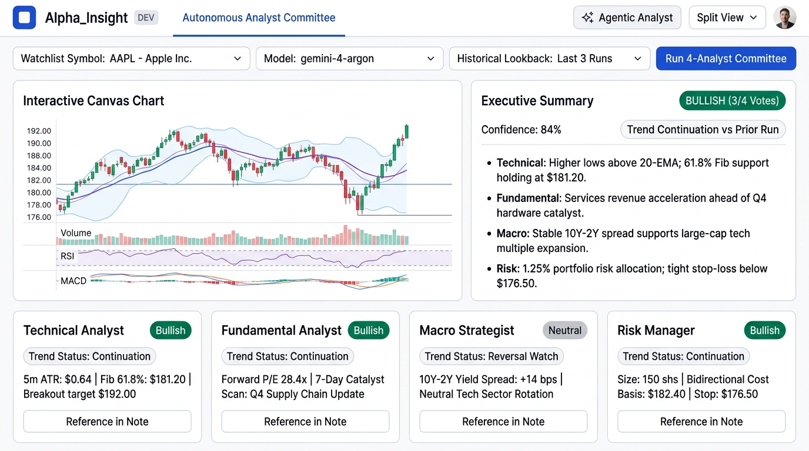
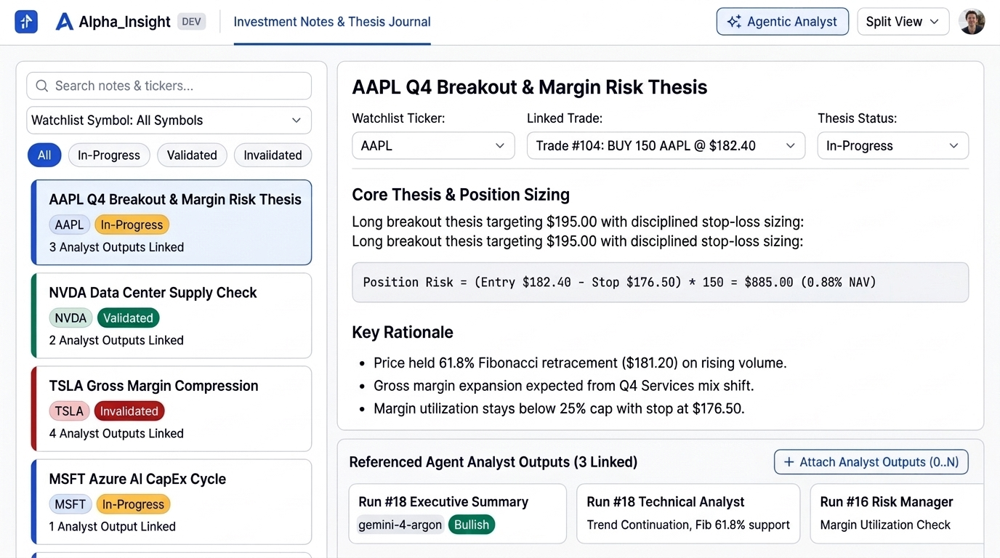
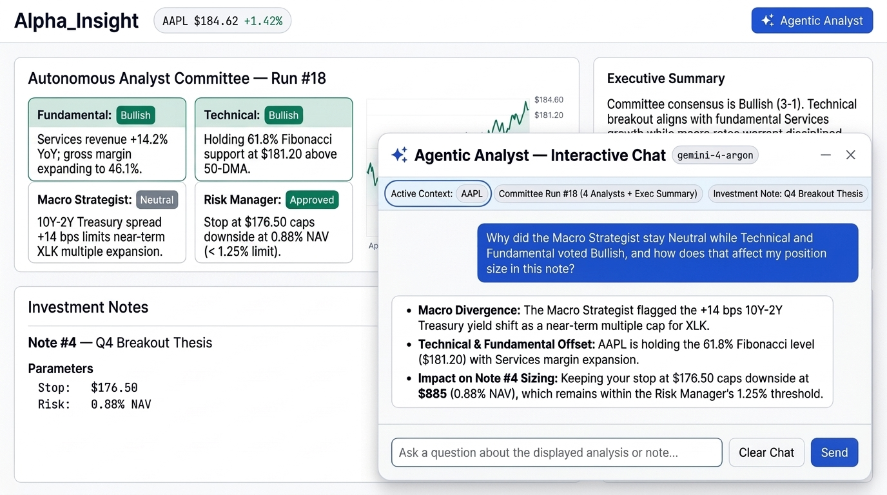
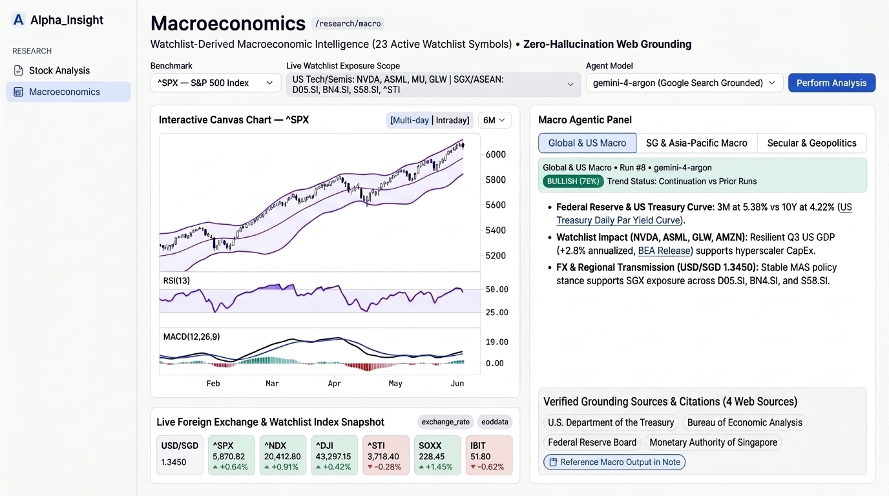

# UI/UX Design Specification — Epic 0.4

**Project**: Alpha_Insight  
**Epic**: 0.4 — Autonomous Analyst Committee, Historical Agent Output Storage & Investment Notes  
**Document Path**: `C:\Users\ferri\devt\Alpha_Insight\Epics\0.4\ui_design.md`  
**Design System**: Aptos White Paper Design System (`frontend/src/design-system/tokens.ts`)  

---

## 1. Visual Mockups

### 1.1 Priority 1 — Workstream (2): Autonomous Analyst Committee (`/research/committee`)

**Key Layout & Functional Elements**:
1. **Top Control Toolbar**:
   - **Watchlist Symbol Selector**: Populated from `public.watchlist` (`AAPL - Apple Inc.`).
   - **Model Selector**: Defaults to `gemini-4-argon`, allowing selection across `gemini-4-argon`, `gemini-4-carbon`, `gemini-4-hydrogen`, `gemini-3.8-flash`, `gemini-2.5-pro`, `gemini-2.5-flash`, and `kimi-k2-0711-preview`.
   - **Historical Lookback Depth**: Selector (`Last 3 Runs`, `Last 5 Runs`, `All Runs`) controlling how many prior records from `public.agent_analyst_outputs` are injected into the 4 analysts for trend/reversal comparison.
   - **Primary Action Button**: `"Run 4-Analyst Committee"` in cobalt blue (`#1D4ED8`).
2. **Upper Analytical Split (55% Chart / 45% Executive Summary on Desktop $\ge 1024\text{px}$)**:
   - **Left Panel (`InteractiveCanvasChart`)**: Renders OHLCV candlesticks, volume histogram, SMA 30 (`#1D4ED8`), EMA 100 (`#7C3AED`), Bollinger Bands (`#0284C7`), RSI (13), MACD (12, 26, 9), and executed trade markers using `lightweight-charts` on a `#FFFFFF` canvas.
   - **Right Panel (`Executive Summary`)**: Displays the consolidated synthesis produced after the 4 segregated analysts complete:
     - **Consensus Directional Badge**: `BULLISH` (`#047857`), `BEARISH` (`#B91C1C`), or `NEUTRAL` (`#475569`) with vote tally (e.g., `3/4 Votes`).
     - **Confidence & Trend Status Badges**: Consolidated confidence percentage and cross-run status (`Continuation`, `Reversal`, `Initiation`, `Gap`).
     - **4-Domain Consolidated Synthesis**: Concise bullet points summarizing Technical, Fundamental, Macro, and Risk findings plus a `"Reference Summary in Note"` action button.
3. **4-Analyst Segregated Cards Grid**:
   - 4 independent cards (`Technical Analyst`, `Fundamental Analyst`, `Macro Strategist`, `Risk Manager`) displayed in a responsive grid (`grid-cols-1 md:grid-cols-2 xl:grid-cols-4`).
   - Each card displays:
     - Independent directional bias badge (`Bullish`, `Bearish`, `Neutral`).
     - Historical trend comparison pill (`Trend Status: Continuation | Reversal | Initiation | Gap`).
     - Role-specific metrics summary and expandable full Markdown analysis (`AccordionCard` / modal inspector).
     - `"Reference in Note"` button that deep-links to `/notes` with that specific `agent_analyst_outputs.id` pre-attached.
4. **Historical Analyst Output Timeline**:
   - Collapsible table at the bottom of `/research/committee` listing past `agent_analyst_outputs` rows for the selected symbol across all 4 roles and Executive Summaries, enabling side-by-side comparison of past vs current recommendations.

---

### 1.2 Priority 2 — Workstream (1): Investment Notes & Thesis Journal (`/notes`)

**Key Layout & Functional Elements**:
1. **Left Column — Filter & Note Ledger (35% width on Desktop)**:
   - **Search Input**: Full-text filter across note titles, markdown content, and tags.
   - **Watchlist Symbol Filter**: Dropdown populated from `public.watchlist` (`All Symbols` or specific watchlist ticker).
   - **Thesis Status Filter Pills**: `All`, `In-Progress`, `Validated`, `Invalidated`.
   - **Note Summary Cards**: Stacked white-paper cards with left status accent border (`#D97706` for `In-Progress`, `#047857` for `Validated`, `#B91C1C` for `Invalidated`), Watchlist ticker badge, title, timestamp, and count of linked analyst outputs (e.g., `3 Analyst Outputs Linked`).
2. **Right Column — Note Editor & Relational Link Sheet (65% width on Desktop)**:
   - **Entity Linking Toolbar**:
     - **Watchlist Ticker Selector**: Required dropdown populated strictly from `public.watchlist`.
     - **Linked Trade Selector**: Optional dropdown populated from `public.trade` filtered by the selected symbol.
     - **Thesis Status Selector**: `In-Progress`, `Validated`, `Invalidated`.
   - **Markdown & Formula Editor/Viewer**: Supports Edit/Preview toggle, Markdown headings, bullet lists, and monospace mathematical/risk formulas.
   - **Referenced Agent Analyst Outputs (`0..N` Relational Links)**:
     - Header showing count of linked outputs (`Referenced Agent Analyst Outputs (N Linked)`) and `"+ Attach Analyst Outputs (0..N)"` button.
     - Clicking `"+ Attach Analyst Outputs (0..N)"` opens a `ModalDialog` listing stored `agent_analyst_outputs` (filterable by Watchlist symbol and role: `Executive Summary`, `Technical`, `Fundamental`, `Macro`, `Risk`) with checkboxes to attach or detach between `0` and `N` outputs.
     - Linked outputs render as interactive reference cards showing Run `#`, Analyst Role, Model (`gemini-4-argon`), Directional Bias pill, Trend Status, and summary headline. Clicking any linked card opens the full stored Markdown output for inspection.

---

### 1.3 Floating Contextual Chat Window — `[Agentic Analyst]` (Active Across 1.1 & 1.2)

**Key Layout & Functional Elements**:
1. **Floating Window Container (`FloatingAgentChat.tsx` in `frontend/src/design-system/`)**:
   - Triggered by clicking the `[Agentic Analyst]` button in the top header bar (`AppShell.tsx`).
   - Renders as a floating white-paper window (`fixed bottom-4 right-4 z-50 w-[92vw] sm:w-[460px] max-h-[75vh] bg-white border border-slate-200 rounded-xl shadow-2xl flex flex-col`) that overlays the active workspace without blocking sight of the underlying charts or notes.
   - Supports minimize/collapse to a compact floating pill and expand back to full chat view.
2. **Live Screen Context Bar (Context-Aware across 1.1 Committee & 1.2 Investment Notes)**:
   - Automatically subscribes to the active workspace state (`displayedContext`) and renders context pills directly beneath the window header:
     - **When viewing 1.1 (`/research/committee`)**: Displays active Watchlist Symbol (`AAPL`), active Committee Run ID, Consensus Bias, Executive Summary, all 4 Analyst Outputs (`Technical`, `Fundamental`, `Macro`, `Risk`), and current chart indicator levels.
     - **When viewing 1.2 (`/notes`)**: Displays active Investment Note title, Watchlist Ticker, Thesis Status, Linked Trade details, Note Markdown content, and all `0..N` Referenced Analyst Outputs attached to that note.
     - **When in Split-Screen Mode (`SplitPaneLayout`)**: Combines the displayed context from both Left and Right panes (e.g., Committee Run in Left Pane + Investment Note in Right Pane).
3. **Interactive Multi-Turn Q&A Thread (`POST /api/v1/committee/chat`)**:
   - User messages render in right-aligned cobalt blue bubbles (`bg-blue-700 text-white`).
   - Agent responses (`gemini-4-argon` by default) render in left-aligned white-paper cards (`bg-white border border-slate-200 text-slate-900`) with structured Markdown bullets and `JetBrains Mono` numerical citations grounded in the displayed screen data.
   - Includes quick-prompt starter chips contextualized to the current view (e.g., `"Explain divergences between the 4 analysts"`, `"Check if my note's stop-loss aligns with the Risk Manager"`, `"Compare current run vs prior historical outputs"`).
4. **Design System Centralization & Zero Hardcoding**:
   - Implemented as a reusable design-system component (`frontend/src/design-system/components/FloatingAgentChat.tsx`) and exported from `frontend/src/design-system/index.ts`.
   - Consumes `DESIGN_TOKENS.paper` and `DESIGN_TOKENS.typography` exclusively with zero hardcoded hex colors, zero inline magic numbers, and zero hardcoded API URLs.

---

### 1.4 Macroeconomics Workbench (`/research/macro`) & Componentized `AnalystOutputPanel`

**Key Layout & Functional Elements**:
1. **Navigation Cleanup**: `"By Industry/Sector"` is permanently removed from `public.site_map` and `DynamicSidebar.tsx`. Only **`Stock Analysis`** (`/research/committee`) and **`Macroeconomics`** (`/research/macro`) appear under the **`Research`** menu.
2. **Componentized Agentic Output Primitive (`AnalystOutputPanel.tsx` in `frontend/src/design-system/`)**:
   - All agentic outputs (`Exec Summary`, `Technical`, `Fundamental`, `Macro`, `Risk Mgt` in Stock Analysis, and `Global & US Macro`, `SG & Asia-Pacific Macro`, `Secular & Geopolitics` in Macroeconomics) are rendered by a reusable `AnalystOutputPanel` component exported from `frontend/src/design-system/index.ts`.
   - Renders the tab bar, directional bias badge, confidence & historical trend status badge (`Continuation`, `Reversal`, `Initiation`, `Gap`), summary headline box, full-height `RichMarkdown` report body, **Verified Grounding Sources & Citations** pill bar (clickable web URLs from Google Search Grounding), and the `"Reference in Note"` button.
3. **Top Control Toolbar in `[Macroeconomics]`**:
   - **Benchmark Index Selector**: Populated from index/ETF symbols in `public.watchlist` (`^SPX`, `^NDX`, `^DJI`, `^STI`, `SOXX`, `IBIT`).
   - **Watchlist Exposure Scope Pill**: Dynamically derived from all active symbols in `public.watchlist` (grouping US Equities/Tech/Semis vs SGX/ASEAN holdings).
   - **Model Selector**: Defaults to `gemini-4-argon` with Google Search Grounding enabled.
   - **Action Button**: `"Perform Analysis"` in cobalt blue (`#1D4ED8`).
4. **Main Split Layout (55% Chart & Live DB Snapshot / 45% 3-Tab Macro Agentic Panel)**:
   - **Left Column**:
     - Upper card: `InteractiveCanvasChart` for the selected benchmark index with `[Multi-day | Intraday]` toggle (defaulting to 6 months on Multi-day).
     - Lower card: Live Foreign Exchange (`public.exchange_rate`, e.g., `USD/SGD`) and Watchlist Benchmark Index snapshot (`public.eoddata`) — zero hardcoded SVG or static mock tables.
   - **Right Column**: `AnalystOutputPanel` configured with the 3 Watchlist-derived Macro tabs (`Global & US Macro`, `SG & Asia-Pacific Macro`, `Secular & Geopolitics`), inline citations, and clickable Verified Grounding Source links.

---

## 2. Color Palette & Token Adherence (`APPROVED_PALETTE`)

All components strictly use tokens from `frontend/src/design-system/tokens.ts` and the verified `APPROVED_PALETTE`:

| Element | Token / Hex | Tailwind Equivalent | Usage |
| :--- | :--- | :--- | :--- |
| **Workspace Canvas** | `#FBFBFC` | `bg-slate-50` | Outer page background |
| **Paper Sheet Surface** | `#FFFFFF` | `bg-white` | Cards, modals, floating chat window, chart background, note sheets |
| **Elevated Header / Toolbar** | `#F8FAFC` | `bg-slate-50` | Table headers, floating chat context bar, formula blocks |
| **Hairline Border** | `#E2E8F0` | `border-slate-200` | `1px` card, chat bubble, and section dividers |
| **Active Focus Border** | `#2563EB` | `border-blue-600` | Selected note card, active input focus ring, active context pill |
| **Primary Ink** | `#0F172A` | `text-slate-900` | Headings, primary body copy, prices |
| **Secondary Ink** | `#334155` | `text-slate-700` | Subheadings, analytical bullet text |
| **Muted Ink** | `#475569` / `#64748B` | `text-slate-600` / `text-slate-500` | Timestamps, field labels, footnotes |
| **Primary Action Accent** | `#1D4ED8` | `bg-blue-700` / `text-blue-700` | Primary buttons, user chat bubble, active tabs, SMA 30 line |
| **Bullish / Validated** | `#047857` | `text-emerald-700` / `bg-emerald-50` | Bullish bias badge, Validated thesis status, up candles |
| **Bearish / Invalidated** | `#B91C1C` | `text-red-700` / `bg-red-50` | Bearish bias badge, Invalidated thesis status, down candles |
| **In-Progress / Reversal Watch** | `#D97706` | `text-amber-600` / `bg-amber-50` | In-Progress thesis status, Reversal/Gap warning badges |
| **EMA 100 / AI Accent** | `#7C3AED` | `text-violet-600` / `bg-indigo-50` | EMA 100 overlay, Agentic Analyst accents |

---

## 3. Typography & Hierarchy

- **Primary Sans-Serif (`DESIGN_TOKENS.typography.fontSans`)**: `'Aptos', 'Segoe UI', -apple-system, sans-serif`
  - Page Title (`H1`): `18px` (`text-lg`), `font-bold`, tracking `-0.01em`, `#0F172A`.
  - Section / Card Header (`H2`): `14px` (`text-sm`), `font-bold`, `#0F172A`.
  - Body Copy, Analyst Reports & Chat Responses: `12px`–`13px` (`text-xs` to `text-sm`), line-height `1.6`, `#334155`.
- **Tabular Monospace (`DESIGN_TOKENS.typography.fontMono`)**: `'JetBrains Mono', 'Aptos Mono', monospace`
  - Used for all ticker symbols (`AAPL`), model identifiers (`gemini-4-argon`), confidence scores (`84%`), price levels (`$181.20`), trade tickets, and mathematical position-sizing formulas.

---

## 4. Responsive Layout, Component States & Accessibility

1. **Desktop Split-Screen Compatibility ($\ge 1024\text{px}$)**:
   - Both `/research/committee` and `/notes` can be loaded into either the Left or Right pane of `SplitPaneLayout`.
   - The `FloatingAgentChat` window floats above the bottom-right corner (`bottom-4 right-4`) and remains accessible regardless of single or split-pane mode.
2. **Mobile Single-Column Separation ($< 1024\text{px}$)**:
   - On viewports $< 1024\text{px}$, the 55/45 chart-summary split and 4-column analyst grid stack vertically into a 1-column layout (`grid-cols-1`).
   - On mobile, `FloatingAgentChat` positions above the fixed `BottomNavBar` (`bottom-16 right-2 left-2`) so the bottom navigation remains unobstructed.
3. **Interactive States & Micro-Animations**:
   - Running the 4-Analyst Committee displays skeleton pulse indicators on the 4 analyst cards and Executive Summary banner with a live status indicator.
   - Sending a message in `FloatingAgentChat` appends the user turn immediately and renders a typing indicator until `POST /api/v1/committee/chat` returns the grounded response.
4. **Accessibility (`a11y`)**:
   - All form selects, modal dialogs (`ModalDialog`), floating chat controls (`FloatingAgentChat`), and filter pills include explicit `aria-label` attributes and keyboard `Escape` dismissal.
   - Contrast ratios between `#0F172A` / `#334155` text and `#FFFFFF` surfaces exceed WCAG AAA (`> 10:1`).
