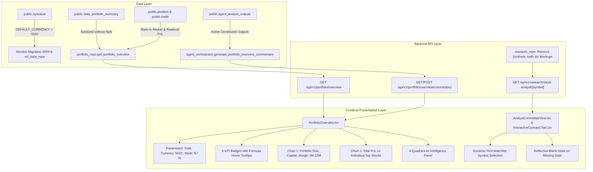

# Implementation Plan — Epic 0.6: Portfolio Overview Upgrade & Stock Analyst Bug-Fix

**Project**: Alpha_Insight  
**Milestone**: Epic 0.6  
**Status**: Ready for Execution Mode Sign-off  
**Document Path**: `C:\Users\ferri\devt\Alpha_Insight\Epics\0.6\IMPLEMENTATION_PLAN.md`  

---

## 1. Technical Scope & Architecture Overview

Epic 0.6 delivers two core objectives:
1. Upgrading `frontend/src/components/portfolio/PortfolioOverview.tsx` from static SVG mockups into an interactive, institutional-grade analytics dashboard with dynamic parameters, 6 formula-backed KPI badges, synchronized dual time-series charts, and 4-quadrant AI portfolio intelligence.
2. Eliminating hardcoded mock data and desynchronized defaults across the `Stock Analyst` suite.

---

## 2. File Modification & Creation Matrix

| File Path | Action | Description |
| :--- | :--- | :--- |
| `alembic/versions/0009_seed_default_currency_sysvalue.py` | **Create** | Idempotent DML migration inserting `('DEFAULT_CURRENCY', 'SGD')` into `public.sysvalue`. |
| `run_mark_to_market.py` | **Modify** | Sanitize `eodprice` using `COALESCE(NULLIF(eodprice, 'NaN'::float), prev_valid_close)` to prevent `NaN` values. |
| `run_portfolio_summary.py` | **Modify** | Add safety guards preventing `NaN` propagation into `daily_portfolio_summary`. |
| `backend/repositories/research_repo.py` | **Modify** | Remove synthetic mock candle generators (lines 291-307, 402-419, 450-464); return empty array `[]` when no rows exist. |
| `backend/repositories/portfolio_repo.py` | **Modify** | Implement robust `get_portfolio_overview` returning KPI badges, Chart 1 series, and Chart 2 multi-line stock breakdown. |
| `backend/services/agent_orchestrator.py` | **Modify** | Implement `generate_portfolio_overview_commentary` synthesizing 4 quadrants from `agent_analyst_outputs` + portfolio stats. |
| `backend/api/v1/portfolio.py` | **Modify** | Expose `/overview`, `/overview/commentary`, and `/overview/commentary/refresh`. |
| `frontend/src/types/api.ts` | **Modify** | Add TypeScript definitions for `PortfolioOverviewResponse` and `PortfolioCommentaryResponse`. |
| `frontend/src/services/apiClient.ts` | **Modify** | Add API client methods for overview data and AI commentary caching. |
| `frontend/src/App.tsx` | **Modify** | Remove hardcoded `'AAPL'` defaults; initialize `selectedSymbol` dynamically from the user's watchlist. |
| `frontend/src/components/research/AnalystCommitteeView.tsx` | **Modify** | Remove mock watchlist fallback; synchronize `selectedSymbol` with actual first watchlist item; handle empty states. |
| `frontend/src/components/research/StockAnalystView.tsx` | **Modify** | Remove hardcoded mock ticker arrays. |
| `frontend/src/components/portfolio/PortfolioOverview.tsx` | **Rewrite** | Production implementation with Top Parameters, 6 KPI badges with formula tooltips, Dual Charts, and AI Commentary. |
| `tests/backend/test_portfolio_overview.py` | **Create** | Comprehensive backend tests for overview calculations, currency translation, and empty fallbacks. |
| `tests/backend/test_research_no_mock.py` | **Create** | Test verifying that missing EOD/tick data returns empty `[]` without synthetic candles. |
| `tests/frontend/portfolio_overview.test.tsx` | **Create** | Vitest unit tests verifying badge formulas, mode switches, and chart toggles. |
| `tests/frontend/analyst_committee_sync.test.tsx` | **Create** | Vitest unit tests verifying watchlist synchronization and blank state rendering. |

---

## 3. Skill & Persona Allocation

- **Spec Orchestrator (`spec-orchestrator`)**:
  - Maintains project requirements, validates architectural boundaries, and audits final deliverables against PRD and UAT checklist.
- **Logic Generator / Swarm Workers (`logic-generator` / `backend-worker`, `frontend-worker`, `test-worker`)**:
  - Implements backend endpoints, batch sanitization, frontend UI components, and unit/integration tests.
- **Deterministic Resolver (`deterministic-resolver`)**:
  - Executes and validates terminal outputs across Ruff, Mypy, Pytest, and Vitest.

---

## 4. Engineering Standards & Test Strategy

1. **Typing & Schema Contracts**:
   - Backend responses strictly typed with Pydantic v2 schemas.
   - Frontend components strictly typed with TypeScript interfaces matching OpenAPI models.
2. **Anti-Hardcoding Standard**:
   - Zero hardcoded mock arrays, synthetic pricing algorithms, or hardcoded URLs.
   - Base currency defaults to `public.sysvalue` (`'SGD'`).
3. **Data Precision & Edge Cases**:
   - Handle empty watchlists, zero injected capital, zero open positions, and missing market data gracefully without division-by-zero or `NaN`.
4. **CI-Parity Verification Gate**:
   - Full 3-Tier gate must pass with exit code `0` across the workspace root `.`:
     - Tier 1: `uv run ruff check .` and `uv run ruff format --check .`
     - Tier 2: `uv run mypy`
     - Tier 3: `uv run pytest` and `npx vitest run`
