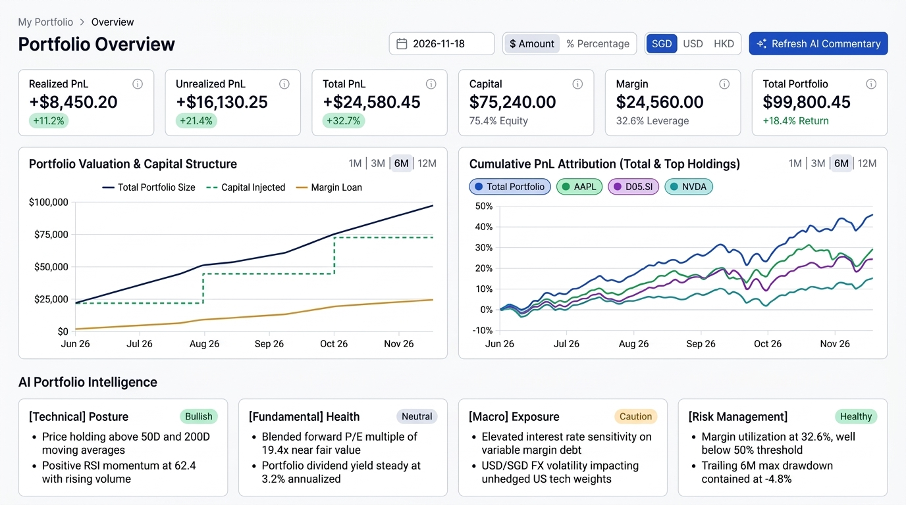

# UI/UX Design Specification — Epic 0.6: Portfolio Overview Upgrade

**Project**: Alpha_Insight  
**Milestone**: Epic 0.6  
**Status**: Draft for User Sign-off  
**Design System**: Aptos White Paper Design System (`frontend/src/design-system/tokens.ts`)  
**Document Path**: `C:\Users\ferri\devt\Alpha_Insight\Epics\0.6\ui_design.md`  

---

## 1. Visual Mockups



*Figure 1.1: Institutional Portfolio Overview dashboard layout showing top parameters, 6 KPI badges with rollover formulas, synchronized dual time-series charts, and 4-quadrant AI commentary panel.*

---

## 2. Design Philosophy & Aesthetic Foundation

The Portfolio Overview interface adheres to the **Aptos White Paper** aesthetic established in Epic 0.2 and expanded in Epics 0.3 and 0.4:
- **Clean Paper Canvas**: Utilitarian, distraction-free off-white canvas (`#FBFBFC`) with crisp white card surfaces (`#FFFFFF`).
- **Razor-Thin Architecture**: Sharp, hairline borders (`#E2E8F0` and `#CBD5E1`) separating functional regions without heavy drop shadows.
- **Deep Ink Typography**: High-contrast slate typography (`#0F172A` primary ink, `#475569` secondary text) paired with Aptos and monospace JetBrains Mono for all numeric values.
- **Institutional Color Accents**: Cobalt blue (`#1D4ED8`) for primary actions and active selections, emerald green (`#047857`) for positive gains and healthy status, crimson red (`#B91C1C`) for losses or elevated risk, and amber (`#D97706`) for cautionary alerts and leverage notices.

---

## 3. Layout Structure & Responsive Grid

The page is structured as a vertical sequence of 4 primary sections:

```
+---------------------------------------------------------------------------------------------------+
| 1. Top Parameters Toolbar                                                                         |
|    Title & Breadcrumb | Date Picker [2026-11-18] | Mode [ $ | % ] | CCY [ SGD | USD | HKD ] | Refresh |
+---------------------------------------------------------------------------------------------------+
| 2. KPI Metric Badges Strip (Responsive Grid: 2 cols on mobile, 3 on tablet, 6 on desktop)        |
|    [ Realized PnL ] [ Unrealized PnL ] [ Total PnL ] [ Capital ] [ Margin Loan ] [ Total Portfolio]|
+---------------------------------------------------------------------------------------------------+
| 3. Synchronized Dual Time-Series Charts (1 col mobile/tablet, 2 cols desktop >= 1024px)          |
|    +------------------------------------------+ +-----------------------------------------------+ |
|    | Chart 1: Valuation & Capital Structure   | | Chart 2: PnL Attribution (Total & Top Stocks)  | |
|    | [1M | 3M | 6M | 12M]                     | | [1M | 3M | 6M | 12M] [Legend Filter Pills]     | |
|    | (Total Size, Capital, Margin Loan)       | | (Total PnL vs AAPL, D05.SI, NVDA, etc.)        | |
|    +------------------------------------------+ +-----------------------------------------------+ |
+---------------------------------------------------------------------------------------------------+
| 4. AI Portfolio Intelligence (4-Quadrant Grid: 1 col mobile, 2 cols tablet, 4 cols desktop)       |
|    [ Technical ]        [ Fundamental ]        [ Macroeconomic ]       [ Risk Management ]        |
+---------------------------------------------------------------------------------------------------+
```

---

## 4. Component Specifications

### 4.1 Top Parameters Toolbar
- **Container**: White paper card (`#FFFFFF`), border `#E2E8F0`, rounded 8px (`rounded-lg`), padding `p-4`.
- **Date Selector**:
  - Native HTML5 date input with calendar trigger icon.
  - Border `#CBD5E1`, text `#0F172A`, font-mono text-xs.
  - Defaults to `GLOBAL_TODAY` (`2026-11-18`).
- **Amount / % Segmented Toggle**:
  - Two-state pill switch (`[$] Amount` vs. `[%] Percentage`).
  - Active tab: `#1D4ED8` background with `#FFFFFF` text and subtle elevation.
  - Inactive tab: `#F1F5F9` background with `#475569` text, hover `#E2E8F0`.
- **Currency Selector**:
  - Dynamic pill group (`SGD`, `USD`, `HKD`).
  - Defaults to value configured in `public.sysvalue` (`DEFAULT_CURRENCY = 'SGD'`).
  - Active pill: `#FFFFFF` surface with `#1D4ED8` text, `#1D4ED8` border, font-bold font-mono.
  - Inactive pill: `#F8FAFC` surface with `#64748B` text, `#CBD5E1` border.
- **Refresh AI Commentary Action**:
  - Button styled with `#1D4ED8` border/accent, icon spinning state when loading.

---

### 4.2 KPI Metric Badges Strip
Six uniform cards (`BentoCard` pattern) configured in a grid (`grid-cols-2 sm:grid-cols-3 xl:grid-cols-6 gap-3`):
1. **Header Row**:
   - Metric Label (`text-xs font-semibold text-slate-500 uppercase tracking-wider`).
   - Formula Tooltip Indicator: Subtle `(i)` icon in top right corner. Hovering opens an accessible floating tooltip showing the exact arithmetic formula.
2. **Primary Value Display**:
   - `font-mono text-lg font-bold tracking-tight`.
   - In **Amount Mode**: formatted as currency (`+$8,450.20`, `$75,240.00`).
   - In **% Mode**: formatted as percentage with 2 decimal places (`+11.23%`, `75.38%`).
   - Semantic coloring: Positive values in `#047857` (emerald), negative values in `#B91C1C` (crimson), neutral/capital in `#0F172A`.
3. **Subtext Line**:
   - Monospace secondary indicator showing the alternate mode value in parens (e.g., if Amount mode is active, subtext displays percentage in brackets `[+11.23%]`, and vice versa).

#### Tooltip Formula Definitions (Rollover UI):
- **Realized PnL**: `Realized PnL / Total Injected Capital * 100`
- **Unrealized PnL**: `Unrealized PnL / Total Injected Capital * 100`
- **Total PnL**: `(Realized PnL + Unrealized PnL - Cumulative Margin Interest) / Total Injected Capital * 100`
- **Capital**: `Total Injected Capital / Total Asset Value * 100 (Equity Ratio)`
- **Margin**: `Drawn Margin Loan / Total Injected Capital * 100 (Leverage Utilization)`
- **Total Portfolio**: `Total Portfolio Net Asset Value / Period % Return over timeframe`

---

### 4.3 Synchronized Dual Time-Series Charts

#### Chart 1: Portfolio Valuation & Capital Structure
- **Container**: `ChartContainer` with title, subtitle, and timeframe pills (`1M`, `3M`, `6M`, `12M`).
- **Series Lines**:
  - `Total Portfolio Size`: Solid cobalt line (`#1D4ED8`, stroke 2.5px) with soft gradient area fill (`stopOpacity: 0.12` to `0.0`).
  - `Capital`: Dashed emerald line (`#047857`, stroke 2px, dasharray 4 3).
  - `Margin Loan`: Amber line (`#D97706`, stroke 2px).
- **Y-Axis**:
  - In Amount mode: currency formatted values ($0, $25K, $50K, $75K, $100K).
  - In % mode: relative percentage indexed to start date (0% baseline).

#### Chart 2: Cumulative PnL Attribution (Total & Top Holdings)
- **Container**: `ChartContainer` with title, subtitle, timeframe pills, and interactive ticker legend bar.
- **Series Lines**:
  - `Total Portfolio PnL`: Thick high-contrast dark ink line (`#0F172A`, stroke 2.5px).
  - `Stock 1 (AAPL)`: Emerald line (`#047857`, stroke 1.75px).
  - `Stock 2 (D05.SI)`: Purple line (`#7C3AED`, stroke 1.75px).
  - `Stock 3 (NVDA)`: Cyan/Teal line (`#0D9488`, stroke 1.75px).
  - `Stock 4 (TSLA)`: Rose line (`#E11D48`, stroke 1.75px).
- **Interactive Legend Bar**:
  - Ticker pills displayed along the top edge of the chart card.
  - Clicking any ticker pill toggles that stock's line visibility on/off. Inactive pill dims to `#94A3B8` with strikethrough.
- **Crosshair Synchronization**:
  - Hovering over either Chart 1 or Chart 2 renders a synchronized vertical hairline crosshair (`#64748B`, stroke-dasharray 2 2) at the corresponding date on both charts simultaneously.
  - Floating tooltip card displays exact point-in-time metrics for both charts.

---

### 4.4 AI Portfolio Intelligence (4-Quadrant Grid)
Four bento cards (`grid-cols-1 md:grid-cols-2 xl:grid-cols-4 gap-4`):
1. **Header**:
   - Domain Badge: `[Technical]`, `[Fundamental]`, `[Macro]`, `[Risk Management]`.
   - Stance Pill:
     - `Bullish` / `Healthy`: Green pill (`bg-emerald-50 text-emerald-700 border-emerald-200`).
     - `Neutral` / `Fair`: Slate pill (`bg-slate-100 text-slate-700 border-slate-300`).
     - `Caution` / `Bearish`: Amber/Red pill (`bg-amber-50 text-amber-700 border-amber-200`).
2. **Headline**:
   - `text-sm font-semibold text-slate-900 leading-snug`.
3. **Structured Content**:
   - Crisp Markdown bullets (`text-xs text-slate-600 space-y-1.5`).
   - Monospace numeric callouts for moving averages, multiples, FX rates, and margin ratios.
4. **Footer**:
   - Cache timestamp (e.g. `Updated 2026-11-20 09:30 SGT`).

---

## 5. Micro-Animations & Interactive Transitions

- **Badge Value Flip**: When toggling between `[$]` and `[%]`, numeric values transition smoothly with a 150ms opacity crossfade.
- **Pill Selection**: Active pill tab sliding transition using CSS `transition: all 180ms cubic-bezier(0.4, 0, 0.2, 1)`.
- **Chart Line Toggles**: When hiding/showing a stock line in Chart 2, the SVG path fades with `opacity 200ms ease-in-out`.
- **Tooltip Rollover**: Formula tooltip appears on hover with 100ms fade-in and subtle 2px upward translate (`transform: translateY(-2px)`).
- **Button Loading**: "Refresh AI Commentary" displays a smooth rotating CSS spinner on the icon while the request is in flight.

---

## 6. Accessibility & Design Tokens Reference

| Token Name | Token Hex / Value | Usage in Epic 0.6 |
| :--- | :--- | :--- |
| `paper.canvas` | `#FBFBFC` | Main application background behind overview cards. |
| `paper.surface` | `#FFFFFF` | Card backgrounds for Toolbar, Badges, Charts, AI Bento. |
| `paper.border` | `#E2E8F0` | Default border separating cards and grid sections. |
| `paper.borderSoft` | `#CBD5E1` | Input fields, inactive tabs, secondary dividers. |
| `paper.textPrimary` | `#0F172A` | Primary ink for headings, numbers, and primary labels. |
| `paper.textSecondary` | `#334155` | Secondary text, chart axis labels, subtext. |
| `paper.accent` | `#1D4ED8` | Active pill selector, primary line in Chart 1, refresh icon. |
| `paper.accentGreen` | `#047857` | Realized/Unrealized positive PnL, Capital line in Chart 1. |
| `paper.accentRed` | `#B91C1C` | Drawdowns, negative PnL, elevated risk indicator. |
| `paper.accentAmber` | `#D97706` | Margin loan line, leverage ratio, macro caution badge. |
| `typography.fontSans` | `'Aptos', sans-serif` | Headings, labels, commentary text. |
| `typography.fontMono` | `'JetBrains Mono', monospace` | Badges, currency values, percentages, chart tooltips. |
