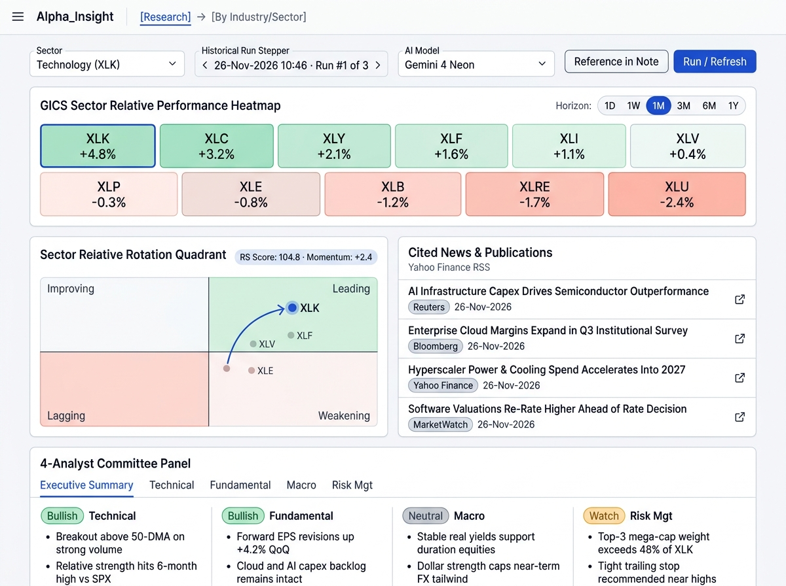
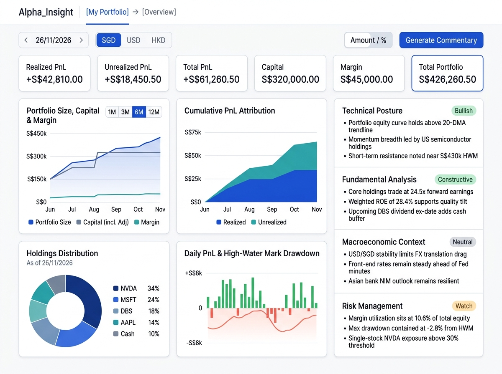

# UI/UX Design Specification — Epic 1.1: By Industry / Sector Research & Portfolio Overview Refinements

**Project**: `Alpha_Insight`  
**Milestone**: Epic 1.1  
**Status**: Draft for User Sign-off (`proceed`)  
**Design System**: Aptos White Paper Design System (`frontend/src/design-system/tokens.ts`)  
**Document Path**: `C:\Users\ferri\devt\Alpha_Insight\Epics\1.1\ui_design.md`  

---

## 1. Visual Mockups

### Figure 1: By Industry / Sector Research Suite

*Figure 1.1: GICS Sector Research interface featuring the sector switcher and timeline stepper, 11-sector performance heatmap, Relative Rotation Quadrant card, cited news publications, and 4-analyst committee tabs.*

### Figure 2: Portfolio Overview 2-Column Layout Refinement

*Figure 2.1: Portfolio Overview 2-column dashboard layout showing top parameter toolbar with "Generate Commentary", 6 KPI badges, Left Column charts (including Holdings Pie Chart and folded Capital adjustments), and Right Column AI commentary.*

---

## 2. Design Foundation & Aptos White Paper System

The interface adheres strictly to the **Aptos White Paper** aesthetic:
- **Paper Canvas**: Crisp, neutral background (`#FBFBFC`) with elevated card containers (`#FFFFFF`).
- **Hairline Borders**: 1px subtle borders (`#E2E8F0` and `#CBD5E1`) without heavy drop shadows.
- **Institutional Typography**:
  - Primary UI text: Aptos (`font-sans`, `#0F172A`).
  - Monospace Financials: JetBrains Mono (`font-mono`, `#1E293B`) for all prices, percentages, shares, and dates.
- **Institutional Color Tokens**:
  - Primary Action / Selection: Cobalt Blue (`#1D4ED8`, `bg-blue-700`, `text-blue-700`).
  - Positive Performance: Emerald Green (`#047857`, `text-emerald-700`, `bg-emerald-50`).
  - Negative Performance: Crimson Red (`#B91C1C`, `text-red-700`, `bg-red-50`).
  - Caution / Advisory: Amber (`#D97706`, `text-amber-700`, `bg-amber-50`).
  - Leading Rotation: Emerald (`#059669`).
  - Weakening Rotation: Amber (`#D97706`).
  - Lagging Rotation: Crimson (`#DC2626`).
  - Improving Rotation: Cobalt Blue (`#2563EB`).

---

## 3. Screen 1: `[Research] -> [By Industry/Sector]` Specification

```
+-----------------------------------------------------------------------------------------------------------------------+
| 1. Top Control Bar                                                                                                    |
|    Sector Dropdown: [ XLK · Information Technology v ]  < [ 26-Nov-2026 10:46 · Run #1 of 3 ] >  Model: [Gemini 4 Neon]|
|    [ Refresh Analysis ]  [ Reference in Note ]                                                                         |
+-----------------------------------------------------------------------------------------------------------------------+
| 2. 11 GICS Sectors Relative Performance Heatmap & Metric Table                                                        |
|    Horizon: [ 1D | 1W | 1M | 3M | 6M | 1Y ]    Benchmark SPY: +0.75%                                                 |
|    +-------------+ +-------------+ +-------------+ +-------------+ +-------------+ +-------------+                     |
|    | XLK +1.85%  | | XLF +0.92%  | | XLC +1.10%  | | XLI +0.45%  | | XLE -0.80%  | | XLV -0.35%  | ... (11 sectors)    |
|    +-------------+ +-------------+ +-------------+ +-------------+ +-------------+ +-------------+                     |
+-----------------------------------------------------------+-----------------------------------------------------------+
| 3. Relative Rotation Quadrant Card                        | 4. Cited News & Publications Panel                        |
|    Sector: XLK vs SPY Benchmark                           |    Yahoo Finance RSS Headlines & Google Grounding Links   |
|    Current Quadrant: [ LEADING ] (RS: 1.042, Mom: +0.015) |    • State Street XLK Adds Apple & Nvidia (Yahoo Finance) |
|    +---------------------------------------------------+  |      Published: 24-Nov-2026 · [ Open Article -> ]         |
|    |      IMPROVING      |        LEADING (XLK*)       |  |    • Semiconductor Outlook & Capex Cycles (Seeking Alpha) |
|    |---------------------+-----------------------------|  |      Published: 23-Nov-2026 · [ Open Article -> ]         |
|    |       LAGGING       |        WEAKENING            |  |    • Explanatory note: How news influenced committee      |
|    +---------------------------------------------------+  |                                                           |
|    (i) Formula Explanation Popover                        |                                                           |
+-----------------------------------------------------------+-----------------------------------------------------------+
| 5. 4-Analyst Committee Intelligence Panel                                                                             |
|    [ Executive Summary ]  [ Technical ]  [ Fundamental ]  [ Macroeconomic ]  [ Risk Management ]                      |
|    Stance: [ BULLISH (3/4) ] · Confidence: 84% · Trend: Continuation                                                  |
|    Consolidated Sector Thesis, Catalysts, Constituent Revisions, and Downside Scenarios                               |
+-----------------------------------------------------------------------------------------------------------------------+
```

### 3.1 Control Bar Components
- **Sector Switcher**: Select dropdown featuring all 11 GICS sector ETFs (`XLK`, `XLF`, `XLV`, `XLE`, `XLI`, `XLC`, `XLY`, `XLP`, `XLB`, `XLU`, `XLRE`).
- **Run Stepper**: Shared timeline selector `< [Date/Time · Run #X of N] >` for navigating historical committee runs.
- **Model Selector**: Dropdown defaulting to `Gemini 4 Neon`.
- **Action Buttons**:
  - `Refresh Analysis`: Cobalt button with loading spinner.
  - `Reference in Note`: Secondary outline button opening the note composer with the sector report pre-filled.

### 3.2 Rotation Quadrant Explanatory Card
- **Visual Quadrant Coordinate**:
  - $X$-axis: Relative Strength vs `SPY` ($RS = \frac{Sector_{1M}}{SPY_{1M}}$). Centerline at $1.0$.
  - $Y$-axis: Relative Strength Momentum ($RS_t - RS_{t-5}$). Centerline at $0.0$.
- **Interactive Explanatory Tooltip**:
  - Hovering on the info icon opens an explanation popover defining the 4 rotation phases:
    - **Leading**: Outperforming SPY with expanding relative momentum.
    - **Weakening**: Outperforming SPY but losing relative momentum.
    - **Lagging**: Underperforming SPY with deteriorating relative momentum.
    - **Improving**: Underperforming SPY but regaining relative momentum.

### 3.3 Cited News & Publications Panel
- Displays up to 5 verified recent news items fetched from Yahoo Finance RSS and Gemini Google Search Grounding.
- Each item displays:
  - Article Headline (`text-xs font-semibold text-slate-900`).
  - Source Publisher & Date badge (`text-[10px] text-slate-500 font-mono`).
  - External link icon opening the verified source in a new tab.

### 3.4 AI Provider Fallback Alert Banner
- **Trigger**: Appears above commentary panels whenever the AI provider call encounters credit depletion (`402 RESOURCE_EXHAUSTED`), quota limits, or network errors and falls back to deterministic output.
- **Styling**:
  - Container: Soft amber card (`bg-amber-50/80`, border `border-amber-200`, rounded `rounded-lg`, padding `p-3`).
  - Icon: `AlertTriangle` in amber (`w-4 h-4 text-amber-600 shrink-0`).
  - Text: High-contrast amber text (`text-xs text-amber-900`):
    `AI Provider Notice: Google Gemini credits depleted (402 RESOURCE_EXHAUSTED). Operating in deterministic fallback mode.`
  - Action Link: Pill button (`text-[11px] font-semibold bg-amber-100 hover:bg-amber-200 text-amber-900 px-2.5 py-1 rounded border border-amber-300 transition-colors`) reading `"Manage Billing & Credits ↗"`, opening `https://ai.studio/projects` in a new tab.
- **Scope**: Reused across `AnalystCommitteeView`, `MacroeconomicsView`, `IndustrySectorView`, and `PortfolioOverview`.

---

## 4. Screen 2: `[My Portfolio] -> [Overview]` 2-Column Restructuring

```
+-----------------------------------------------------------------------------------------------------------------------+
| Top Parameter Bar: Date: < [ 26/11/2026 ] > | Mode: [ $ | % ] | CCY: [ SGD | USD | HKD ] | [ Generate Commentary ] | ^|
+-----------------------------------------------------------------------------------------------------------------------+
| KPI Badges Strip (6 Cards):                                                                                           |
| [ Realized PnL ] [ Unrealized PnL ] [ Total PnL ] [ Capital ] [ Margin Loan ] [ Total Portfolio: $838,823.16 ]        |
|                                                                                 (Aggregated Holdings Market Value)    |
+-----------------------------------------------------------+-----------------------------------------------------------+
| LEFT COLUMN: Graphs & Charts (7 cols / ~58% width)         | RIGHT COLUMN: AI Portfolio Commentary (5 cols / ~42%)     |
|                                                           | (Clean cards, no title heading, vertical stack)           |
| [ 1M | 3M | (6M) | 12M ]                                  |                                                           |
|                                                           | +-------------------------------------------------------+ |
| +-------------------------------------------------------+ | | [~] TECHNICAL POSTURE                       [Bearish] | |
| | CHART 1: Portfolio Size, Capital & Margin (SGD)       | | | - Core holdings hold medium-term support levels.      | |
| | [x] Size  [x] Capital (w/ Adj)  [x] Margin  [ ] Trades| | | - SMA(30) trailing stop at $96.41.                  | |
| | (Capital line renders adjustment circles directly)    | | +-------------------------------------------------------+ |
| +-------------------------------------------------------+ | | [o] FUNDAMENTAL ANALYSIS                   [Cautious] | |
|                                                           | | - Deployed equity capital underpins portfolio value.  | |
| +-------------------------------------------------------+ | | - Net return on invested capital stands at -39.53%.   | |
| | CHART 2: Cumulative PnL Attribution (SGD)             | | +-------------------------------------------------------+ |
| | [x] Total  [x] 0700.HK  [x] 9988.HK  [x] 5E2.SI       | | | [^] MACROECONOMIC CONTEXT                   [Caution] | |
| +-------------------------------------------------------+ | | - SGD base currency with multi-currency exposure.     | |
|                                                           | | - Foreign exchange fluctuation hedged across reserves.| |
| +-------------------------------------------------------+ | +-------------------------------------------------------+ |
| | CHART 3: Holdings Distribution Pie Chart              | | | [!] RISK MANAGEMENT                        [Elevated] | |
| | Interactive SVG pie chart as of [ 26/11/2026 ]        | | | - Margin loan utilization at 147% of capital.         | |
| | (Hover slice highlights symbol, value, weight %)      | | | - Drawdown containment bands actively monitored.      | |
| +-------------------------------------------------------+ | +-------------------------------------------------------+ |
|                                                           |                                                           |
| +-------------------------------------------------------+ |                                                           |
| | CHART 4: Daily PnL & High-Water Mark Drawdown         | |                                                           |
| +-------------------------------------------------------+ |                                                           |
+-----------------------------------------------------------+-----------------------------------------------------------+
```

### 4.1 Key Refinements Implemented
1. **Dynamic Default Date**:
   - Resolves to `max(date)` of `daily_portfolio_summary` (e.g. `2026-11-26`) on initial load.
2. **Default Timeframe (`6M`)**:
   - Timeframe pill selector defaults to `6M` instead of `12M`.
3. **Chart 1 Legend & Capital Adjustment Folding**:
   - `Capital Adj` checkbox is removed from the legend.
   - Checking `Capital` displays both the blue capital curve line and the circular deposit/withdrawal event annotations.
4. **Holdings Distribution Pie Chart (Chart 3)**:
   - Replaces the progress bar list with an interactive SVG Pie/Donut Chart.
   - Slices colored using institutional categorical palette (`#1D4ED8`, `#047857`, `#D97706`, `#7C3AED`, `#0284C7`, `#B91C1C`).
   - Dynamically re-renders as the user navigates dates via the date picker.
5. **Total Portfolio Badge Formula**:
   - Computed as $\sum (\text{Quantity} \times \text{EOD Price} \times \text{FX Rate})$ across all open positions on the selected date.
   - Formula tooltip updated to: `Aggregation of holdings market value: sum(Quantity * Price * FX)`.
6. **Title Cleanliness**:
   - Removed `Institutional Performance Series` heading and subtitle above the charts.
   - Removed `AI Portfolio Intelligence` title and subtitle from the commentary panel.
7. **Commentary Button Relocation & 2-Column Split**:
   - Button renamed to **"Generate Commentary"** and moved to the top parameters toolbar.
   - Page rendered in a desktop 2-column layout (`grid grid-cols-1 xl:grid-cols-12 gap-5`):
     - Charts in `xl:col-span-7`.
     - AI Commentary in `xl:col-span-5` (sticky alongside the charts).

---

## 5. Responsive Behavior Matrix

| Viewport Breakpoint | Left Column (Charts) | Right Column (Commentary) | KPI Badges Strip |
|---|---|---|---|
| **Mobile (`< 768px`)** | Full width stacked (1 col) | Full width stacked below charts | 2 columns (`grid-cols-2`) |
| **Tablet (`768px – 1023px`)** | Full width (2x2 chart grid) | Full width stacked below charts | 3 columns (`grid-cols-3`) |
| **Desktop (`>= 1024px`)** | 7 columns (`xl:col-span-7`) | 5 columns (`xl:col-span-5`, sticky) | 6 columns (`xl:grid-cols-6`) |

---

## 6. Micro-Animations & Interaction States

1. **Date Stepper & Picker Navigation**:
   - Immediate skeleton pulse on chart canvas while fetching historical date snapshots.
2. **Pie Chart Slice Hover**:
   - Slices expand slightly (`stroke-width: 2px`, `transform: scale(1.02)`) on mouse hover.
   - Tooltip displays symbol name, local market value, base currency converted value, and percentage share.
3. **Quadrant Card Hover**:
   - Info button triggers a smooth fade-in popover with mathematical definitions of RS and Momentum.
4. **Generate Commentary Button**:
   - While generating, icon rotates with `animate-spin` and button text changes to `Generating...`.

---

## 7. Sign-off Request

Please review the UI/UX specifications and visual mockups above. To indicate your approval of the design, please reply with **"proceed"**.  
Upon your sign-off, we will author the technical **Implementation Plan** and prompt you to select the execution mode (**Single-Engineering Thread Mode** or **Swarm Mode**).